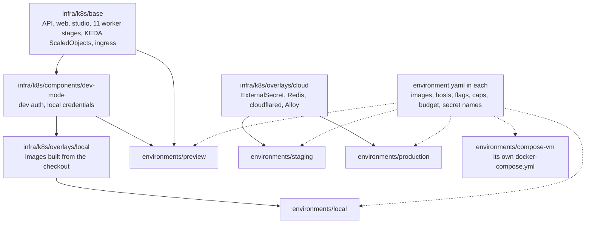
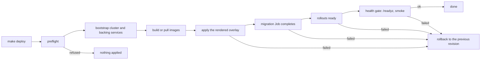

# Deploying

One command per environment, the same way every time: `make deploy ENV=<name>`. This page explains the
model, walks the three first deployments (k3d on your machine, Docker Compose on one VM, k3s on Hetzner with
Cloudflare R2), and covers the day-2 tasks and the go-live checklist.

Everything here that touches a remote machine is opt-in. `make deploy-plan` and `make deploy ... DRY_RUN=1`
change nothing anywhere, and a real deploy of a protected environment refuses to start until it is
confirmed. The local-first rule is unchanged: nothing on this page is needed to run the platform on a laptop
(`make demo`, `make up`).

## Contents

- [The five environments](#the-five-environments)
- [How an environment is built](#how-an-environment-is-built)
- [What a deploy does](#what-a-deploy-does)
- [First deploy from zero](#first-deploy-from-zero)
- [Previews](#previews)
- [Secrets](#secrets)
- [Day 2](#day-2)
- [Go-live checklist](#go-live-checklist)
- [Cost and capacity](#cost-and-capacity)
- [Adding an environment](#adding-an-environment)
- [What is proven and what is not](#what-is-proven-and-what-is-not)
- [When a deploy refuses](#when-a-deploy-refuses)

## The five environments

| Environment | Kind | Where | Images | Use it for |
|---|---|---|---|---|
| `local` | k3d | your machine | built from the checkout | trying a change on Kubernetes: KEDA, ingress, the migration Job |
| `preview` | k3s | a shared cluster, one namespace per branch or PR | registry, `sha-<HEAD>` | showing a change to someone else; deleted after 48 hours |
| `staging` | k3s | its own cluster | registry, `sha-<HEAD>` | rehearsing a release against managed Postgres and R2 |
| `production` | k3s | its own cluster | registry, a pinned release tag | real users |
| `compose-vm` | compose | one VM | registry, a pinned release tag | the smallest real deployment, no Kubernetes |

`make deploy-list` prints them with what each is for. Each has a directory under
[`infra/environments`](../infra/environments/README.md) and a README beside its files.

## How an environment is built

An environment is a directory, not a branch and not a copy of the manifests. It holds a typed
`environment.yaml` (where it deploys, which images, hosts, feature flags, replica ceilings, a resource budget
and the secrets it expects, by name) and a `kustomization.yaml` that only says which overlay it inherits.
Nothing else is repeated: the workloads, probes, KEDA scalers and ingress live once, in `infra/k8s/base`.



At deploy time `pnpm envctl render <env>` writes `.deploy/<env>/kustomization.yaml` (git-ignored): the
environment's own kustomization plus the values from `environment.yaml` as patches. Image tags become
`images:` entries, `scaling.maxReplicas` becomes a patch on each KEDA `ScaledObject`, `hosts` and `features`
and `config` become the `vp-config` ConfigMap, `scaling.budget` becomes a `ResourceQuota`, and a preview gets
its namespace and an expiry annotation. So a value lives in one file and `kustomize build` shows its effect.

[`infra/environments/_template/README.md`](../infra/environments/_template/README.md) explains every field.
`pnpm envctl validate` checks every file against the spec and against the environment schema: a key that does
not exist, a production-mode environment that omits a secret the schema requires, or a protected one that is
not confirmed all fail, here and in `pnpm test:architecture`.

## What a deploy does



Preflight (`make deploy-preflight ENV=<name>` runs it alone and changes nothing) checks, in order:

| Check | Refuses when |
|---|---|
| tools | `kubectl`, `helm`, `k3d`, `docker` or `git` is missing; the message says how to install it (exit 3) |
| environment files | a file fails the spec or the schema (`pnpm envctl validate`) |
| context and confirmation | the current `kubectl` or Docker context is not the one the environment declares, a protected environment has no `--yes` (`YES=1`) or typed name, or its tag is `latest` |
| secrets, by name | an expected secret is missing, empty or a placeholder, or a production value is a credential this repo ships for local use. Names only, never values |
| images | the tag is not in the registry (only a real run asks the registry; a dry run says what it would ask) |
| migrations | a shipped migration was edited, deleted or renamed against `origin/main`: they only grow (production-mode environments; CI checks every pull request) |
| manifests | the overlay does not build, `scripts/validate-k8s.sh` fails, or the compose file is invalid |
| terraform | `terraform fmt -check` fails, when terraform is installed (otherwise skipped, and said so) |
| cluster | the KEDA, Prometheus Operator or External Secrets CRDs the manifests need are not installed |

After the apply, the deploy waits for the `vp-migrate` Job, the rollouts of the API, web and studio, then
polls `/readyz` for `health.readyzTimeoutSec` and, where the environment says `smoke: true`, runs
`scripts/e2e-smoke.sh` (it uploads a clip, so production does not). Any failure rolls every Deployment back
with `kubectl rollout undo` (compose: the previous tag the script recorded) and exits 1. Migrations are
forward-only, so a release must work against the schema of the release before it: add a column in one
release, use it in the next.

Exit codes: 0 ok, 1 failure, 2 usage, 3 prerequisite missing.

## First deploy from zero

Start every one of these with the plan, which applies nothing:

```bash
make deploy-plan ENV=local
make deploy ENV=local DRY_RUN=1
```

### On k3d, on your machine

Needs Docker, `k3d`, `kubectl` and `helm` (`brew install k3d kubectl helm`), `pnpm install` done, and room
in the Docker VM (the images are large; `docker system df` shows how much is free).

```bash
make deploy ENV=local
make deploy-status ENV=local
```

The first run creates the k3d cluster `vp` and installs Postgres, Redis, MinIO, KEDA and the monitoring stack
(`make k3d-up` does this part and still works on its own), builds the four images, imports them, writes
`.secrets/local.env` with a random `ADMIN_TOKEN`, applies the overlay, waits for the migration Job and
`/readyz`, and runs the smoke upload. `make k3d-up && make k3d-deploy` keep their old behaviour; `make
deploy ENV=local` is the same flow with the gates around it. The web app is on `http://localhost:3000`, the
studio on `http://studio.localhost:3000`. `make k3d-down` removes the cluster.

### On one VM with Docker Compose

The smallest real deployment. Postgres is managed (Neon, see
[cloud accounts](runbooks/cloud-accounts.md)) and storage is R2 or any S3; Redis runs in the project.

```bash
docker context create vp-vm --docker "host=ssh://deploy@vm.example.com"
make secrets-check ENV=compose-vm
```

`make secrets-check` lists what `.secrets/compose-vm.env` lacks by name. Create the file with one `KEY=value`
line per name it printed (`DATABASE_URL`, `DATABASE_URL_MIGRATIONS`, `REDIS_PASSWORD`, `S3_ENDPOINT`,
`S3_ACCESS_KEY_ID`, `S3_SECRET_ACCESS_KEY`, `CLOUDFLARE_TUNNEL_TOKEN`), set the hosts and the identity
provider in
[`infra/environments/compose-vm/environment.yaml`](../infra/environments/compose-vm/README.md), then:

```bash
make deploy-plan ENV=compose-vm
make deploy ENV=compose-vm TAG=v1.2.3 YES=1
make deploy-status ENV=compose-vm
```

Compose has no KEDA, so each worker stage runs one container and does not scale; size the VM for the
transcodes you expect. A failed deploy goes back to the tag in `.deploy/compose-vm/current-tag` (the last release that passed its health gate);
`make deploy-rollback` redeploys `.deploy/compose-vm/previous-tag`, or the `TAG=` you pass, from the machine you deploy from.

### On Hetzner k3s with Cloudflare R2

Order matters; each step is something you do once.

1. Accounts: Cloudflare (R2, the tunnel, DNS), Hetzner, Neon, Grafana Cloud. The
   [cloud accounts runbook](runbooks/cloud-accounts.md) and `scripts/cloud-setup-wizard.sh` walk you through
   them and say which values feed which key.
2. Infrastructure: Terraform creates the R2 buckets `vp-raw` and `vp-public`, the CDN hostname, the scoped
   R2 tokens, the tunnel and the Hetzner node. Review before anything is created:

   ```bash
   cd infra/terraform
   cp terraform.tfvars.example terraform.tfvars
   terraform init
   terraform plan
   ```

   `terraform apply` is the one step that creates paid resources; run it yourself when the plan is what you
   expect. CI runs `terraform fmt` and `validate` on every change.
3. The node: `scripts/k3s-cloud-provision.sh <vps-ip> <ssh-user>` installs k3s, Traefik and KEDA. The deploy
   also needs the External Secrets Operator and the Prometheus Operator CRDs; `make deploy-preflight` names
   any that are missing. Copy the node's kubeconfig, point it at the public address, and name the context
   exactly what the environment declares (`k3s-production`, `k3s-staging`):

   ```bash
   scp root@<vps-ip>:/etc/rancher/k3s/k3s.yaml ~/.kube/vp-production.yaml
   KUBECONFIG=~/.kube/vp-production.yaml kubectl config rename-context default k3s-production
   ```

4. Secrets: put the values in the secret manager behind the `vp-secret-store` ClusterSecretStore under
   `video-pipeline/<KEY>`, and keep the same names in `.secrets/production.env` to check against
   ([Secrets](#secrets)).
5. Set the real hosts, identity provider URLs and replica ceilings in
   [`infra/environments/production/environment.yaml`](../infra/environments/production/README.md).
6. Push the images for a release (the Images workflow pushes on a `v*` tag, or run it by hand with `push`),
   then:

   ```bash
   make secrets-check ENV=production
   make deploy-preflight ENV=production TAG=v1.2.3
   make deploy-plan ENV=production TAG=v1.2.3
   make deploy ENV=production TAG=v1.2.3 YES=1
   ```

   `/readyz` answers 503 while Postgres, Redis or storage is unreachable (`make chaos-readiness` proves it
   locally), so the first deploy that passes the gate also shows the R2 settings work.

## Previews

`make deploy ENV=preview SLUG=feat/new-player` deploys the current commit into the namespace
`preview-feat-new-player` on the staging cluster: Postgres, Redis and MinIO from Helm with no persistent
volume, one replica of each stage at most, captions and screening off, a `ResourceQuota` of 4 CPU and 8 GiB
requests, and the annotation `vp.dev/expires-at` 48 hours out. The images must exist at `sha-<HEAD>`.

A preview runs dev auth with the repo's local credentials, so it is never given a public host. Reach it with
`kubectl -n preview-feat-new-player port-forward svc/vp-web 5173:5173`.

```bash
make deploy-plan ENV=preview SLUG=feat/new-player
make deploy-status ENV=preview SLUG=feat/new-player
make deploy-expire-previews
make deploy-expire-previews APPLY=1
```

`deploy-expire-previews` lists every preview namespace past its expiry (one with no valid annotation counts
as expired) and deletes nothing until you pass `APPLY=1`. Deleting the namespace removes its Helm releases and
everything in them. Redeploying a preview does not renew its expiry unless you deploy again. Wiring a
workflow that deploys a preview per pull request and runs the expiry on a schedule needs cluster credentials
in CI, and is not set up here.

## Secrets

The rule from the schema holds in every environment: a secret has no default, and nothing secret-shaped is
committed, encrypted or not.

- **Names, by environment.** `secrets.keys` in `environment.yaml` lists the names each environment expects.
  A production-mode environment must list every key the schema marks `production`
  (`DATABASE_URL`, `REDIS_PASSWORD`, `S3_ACCESS_KEY_ID`, `S3_SECRET_ACCESS_KEY`) and
  `pnpm test:architecture` fails, naming the file to edit, when the schema gains one the file lacks. The full
  list with types is [ENVIRONMENT.md](ENVIRONMENT.md), generated by `pnpm gen:env-docs`.
- **Locally and for previews:** `.secrets/<env>.env`, git-ignored, one `KEY=value` per line. The deploy
  writes `ADMIN_TOKEN` there once with a random value.
- **For a cluster in the cloud:** the values live in your secret manager and External Secrets materialises the
  `vp-secrets` Secret (`infra/k8s/overlays/cloud/external-secret.yaml`). `.secrets/<env>.env` is the file you
  keep to seed the store and to check names against. After an apply the deploy compares the key names of the
  Secret in the cluster with `secrets.keys` and prints only names.
- **Sealed Secrets** are a fine alternative where there is no secret manager: encrypt each value for one
  cluster with `kubeseal`, commit the `SealedSecret` under that environment's directory, and add the file to
  its `kustomization.yaml`. It is not wired in because the reference deployment uses External Secrets; if you
  adopt it, drop the `ExternalSecret` from that environment and keep `secrets.keys` as the list of names.
- **Check:** `make secrets-check ENV=production` lists what is missing, empty (or a `<placeholder>`) or a
  credential this repo ships for local use. It prints names and never a value, a length or a hash.

```bash
make secrets-check ENV=production
make secrets-check ENV=compose-vm
```

## Day 2

Every command below accepts `DRY_RUN=1`.

**Upgrade.** Push the release's images (a `v*` tag runs the Images workflow), then
`make deploy ENV=production TAG=v1.3.0 YES=1`. Staging first: `make deploy ENV=staging` deploys `HEAD`.

**Roll back.** `make deploy-rollback ENV=production YES=1` runs `kubectl rollout undo` on every Deployment
labelled `vp.dev/environment=production` and waits for the API. It does not undo a migration: forward-only
means the previous release has to run against the newer schema. On compose it redeploys the recorded previous
tag, or the one you pass as `TAG=`.

**Look.** `make deploy-status ENV=production`, then `make deploy-logs ENV=production SERVICE=worker-probe`
(`SERVICE` is the deployment name without `vp-`; `FOLLOW=1` streams).

**Scale.** Edit `scaling.maxReplicas` (the ceilings KEDA scales to; workers scale to zero when idle) or
`scaling.budget` in the environment's `environment.yaml`, run `make deploy-plan ENV=production`, read the
diff, then deploy. Do not edit the `ScaledObject` in the cluster: the next deploy puts the file's value back.
[scale-to-zero](runbooks/scale-to-zero.md) is the runbook for a worker that does not wake.

**Rotate a secret.** Change the value in the secret manager (or in `.secrets/<env>.env` for the file-based
environments), wait for External Secrets to refresh (`refreshInterval` is an hour; annotate the
`ExternalSecret` with `force-sync` to hurry it) or redeploy, then restart the pods that read it:
`kubectl -n video-pipeline rollout restart deployment/vp-api`, and each worker Deployment. Rotate
`REDIS_PASSWORD` in the store and the Redis StatefulSet together.

**Restore.** The database is the system of record: restore it from your provider's point-in-time recovery (Neon
branches), then `make deploy ENV=production TAG=<tag>` again so the migration Job brings the schema forward.
Redis holds queue state, not the record: after a Redis loss the reconciler re-drives stuck uploads, see
[worker-stuck](runbooks/worker-stuck.md), [job-failure](runbooks/job-failure.md) and
[dlq-replay](runbooks/dlq-replay.md). Objects in R2 are restored
from the bucket's own history; see [storage-outage](runbooks/storage-outage.md) for the symptoms.

## Go-live checklist

- [ ] Accounts and tokens exist, and the R2 live-compatibility test passed
      ([cloud accounts](runbooks/cloud-accounts.md#7-execution-checklist--verification-log)).
- [ ] `terraform plan` was reviewed and `terraform apply` run by you.
- [ ] The cluster has KEDA, the External Secrets Operator and the Prometheus Operator CRDs, and
      `make deploy-preflight ENV=production TAG=<tag>` is clean.
- [ ] `make secrets-check ENV=production` says every expected secret is present, and none is a local credential.
- [ ] The hosts, `AUTH_JWKS_URL`, `AUTH_ISSUER` and `AUTH_AUDIENCE` in `environment.yaml` are yours, not the
      `example.com` placeholders, and the identity provider issues tokens with that audience.
- [ ] `S3_BUCKET_RAW` and `S3_BUCKET_PUBLIC` match the buckets Terraform created.
- [ ] The same tag ran on staging, `/readyz` answered, and the smoke upload reached READY.
- [ ] `scaling.budget` fits the node and `scaling.maxReplicas` is what you will pay for
      ([Cost and capacity](#cost-and-capacity)).
- [ ] The R2 budget alert and the dashboards load; someone knows the
      [runbooks](runbooks/cost-budget.md).
- [ ] You rehearsed `make deploy-rollback ENV=staging`.
- [ ] CODEOWNERS or branch protection means a deploy of `production` needs a second pair of eyes.

## Cost and capacity

- The reference deployment is one Hetzner node (`cax11`, about 6 EUR a month), Neon, R2 and Grafana Cloud on
  free tiers: [cloud accounts](runbooks/cloud-accounts.md) has the limits, SDD section 12.3 the sizing, and
  [cost-budget](runbooks/cost-budget.md) the R2 operations alert at 90% of the free Class A budget.
- A transcode is the expensive unit. `scaling.maxReplicas` caps how many run at once, so it caps the bill and
  the node's load; the cloud environments allow one 1080p and one 720p transcode at a time.
- `scaling.budget` is a `ResourceQuota` on requests, so a stage that scales past what the node can hold
  stays Pending instead of starving the API. Size it to the node.
- A preview costs its namespace's requests while it exists: workers scale to zero, so idle it is the API,
  web, studio and three small Helm releases. The 48-hour expiry is what keeps that bounded.
- `compose-vm` has no autoscaling: a stage that is idle still holds its container. Size the VM for the
  largest stage (captions asks for 2 GiB, screening 1.5 GiB).

## Adding an environment

```bash
make new-environment NAME=qa
make deploy-plan ENV=qa
```

`make new-environment` copies [`_template`](../infra/environments/_template/README.md) and sets the name.
Edit its three files, then add the environment's context to whoever deploys it. `pnpm test:architecture`
renders every directory, so a typo fails there before it fails on a cluster.

## What is proven and what is not

Proven on every change: each environment file parses, lists the secrets the schema requires, renders with
`kustomize build`, and caps the stages it names; the cloud environments carry no secret value and boot under
the schema once their secrets are supplied. `make deploy-plan` and `DRY_RUN=1` run on any machine.

Not proven by CI: a real apply. The cluster flow (bootstrap, apply, rollout, the `/readyz` gate and the
rollback) is exercised by whoever deploys, and the preview and Hetzner paths were written against the manifests
and not run against live clusters. Treat the first deploy of each as a rehearsal on staging.

## When a deploy refuses

| Message | What to do |
|---|---|
| `refusing production: the current context is X, the environment declares Y` | `kubectl config use-context Y`, or fix `cluster.context` if Y is wrong |
| `production is protected: pass --yes` | add `YES=1` (or `CONFIRM=production`) once you have read the plan |
| `production is protected: pin an image tag` | add `TAG=v1.2.3`; `latest` is not a release |
| `missing: ...` from `secrets-check` | add those names to `.secrets/<env>.env` (and the secret store) |
| `<image> is not in the registry` | run the Images workflow with `push`, or pass the tag that exists |
| `<crd> is not installed in this cluster` | install KEDA, the External Secrets Operator or the Prometheus Operator CRDs |
| `was edited` / `was deleted` from the migrations check | restore the shipped file and add a new migration |
| `/readyz did not answer 200` | the deploy rolled back; `make deploy-logs ENV=<env>` and the [API latency runbook](runbooks/api-latency.md) |
