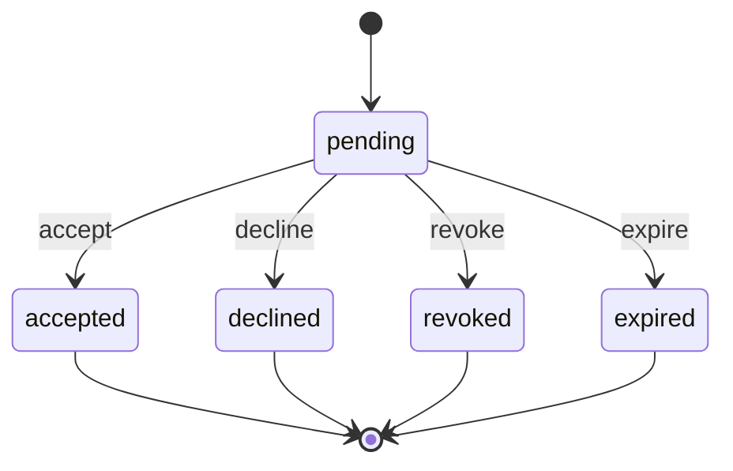
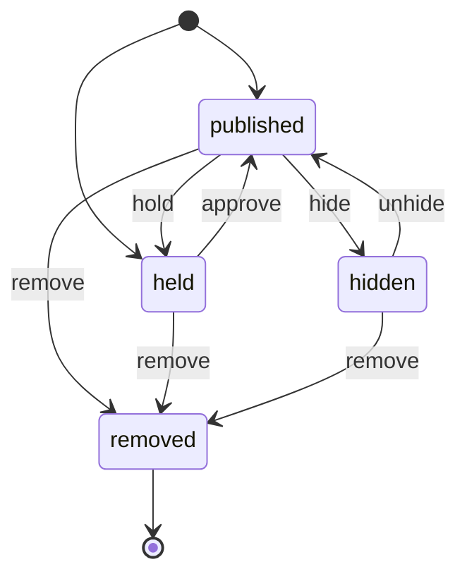
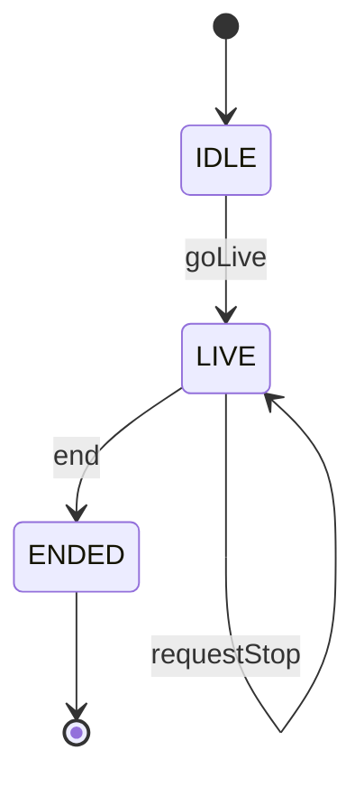
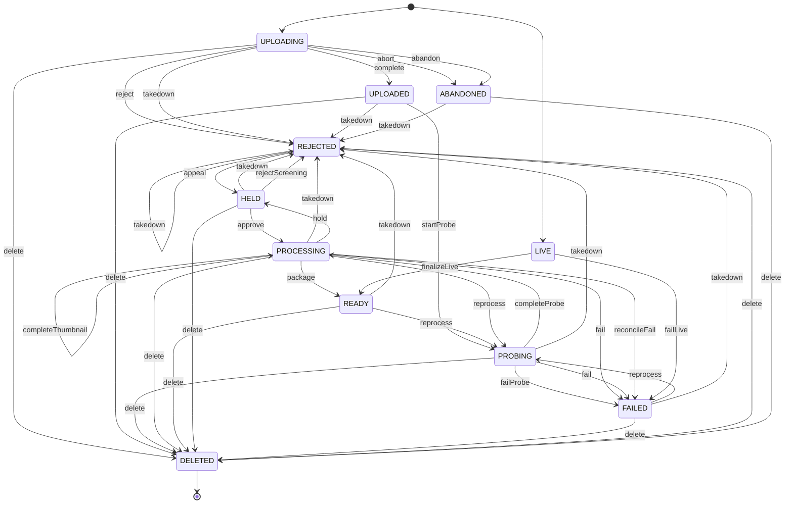

# State machines

> Generated by `pnpm gen:state-machines`. Do not edit it by hand: change the sources and regenerate. CI
> fails when this file is stale. The sources are the `*.machine.ts` files listed under each machine.

A lifecycle is a value whose legal moves depend on its current status, phase or state: a video, a comment,
an invite, a live stream. In this repo each one is a table, not a chain of `status === 'X'` branches.

## Approach

`@vp/machine` (`packages/universal/machine`, no dependencies) holds `defineMachine`. A machine is data: its
states (reused from the `*_VALUES` tuples of `@vp/domain`), its initial and final states, and one edge per
event, `{ from, to, event? }`. It answers one question, "is this edge legal from this state":

- `next(state, event)` returns the next state, or `undefined` when the event does not apply;
- `sources(event)` and `target(event)` read an edge, which replaces the hand-kept eligibility lists;
- `matrix()` lists every state and event pair, for `it.each` and for these diagrams;
- `machineFindings` reports unreachable states, non-final states with no exit, final states with an exit and
  events with no source; `toMermaid` draws the table.

No library: it is about 120 lines, and it adds no second error vocabulary and no runtime to the bundle.

## Rules

1. **States come from the domain tuple.** The machine never spells a status the type does not have.
2. **The machine answers legality, nothing else.** `next` returns `undefined` on a miss and never a failure.
   The rule in `@vp/domain-rules` maps the miss to its existing failure, adds the guards that depend on input
   (a reason is required, a stop was requested) and returns the `Result`.
3. **The CAS helper persists.** The machine says which move is legal; `commitVideoTransition` writes it
   together with its `video_events` row, and its `WHERE status IN (from)` is the database half of the table.
4. **A machine lives in a `*.machine.ts` file** beside the rule that uses it, exporting one `defineMachine(...)`.
5. **No new `status === 'X'` branching outside a machine.** `tests/architecture/state-machines.test.ts` counts
   the existing sites per file and fails on growth, and fails again when a count drops without the baseline
   being lowered.
6. **A behaviour fix is not part of converting a lifecycle.** A conversion reads the table instead of the
   branches and changes no outcome; a bug it exposes goes to the backlog below.

## Adding one

1. Create `<name>.machine.ts` beside the rule, exporting `defineMachine({ name, states, initial, final, events })`.
2. Replace the rule's status comparison with `MACHINE.next(state, event)` and map `undefined` to its failure.
3. Pin the old behaviour first: an `it.each` over every state, event and guard combination, green before the swap.
4. Add `<name>.machine.test.ts` asserting `machineFindings(MACHINE)` is empty.
5. Run `pnpm gen:state-machines` and commit this file.

## When not to

- A two-state boolean (open or closed, dirty or clean).
- A query-cache flag a data library already owns (`isFetching`, `isPending`).
- A total `Record<Union, X>` map that already exists: a map over a union is exhaustive without a machine.
- A one-shot animation or hover phase on a client component.

The ratchet in `tests/architecture/state-machines.test.ts` counts literal status comparisons only. A cluster
of booleans that encodes a mode has no deterministic check, so it is a review question, and the pull request
template asks it.

## Machines

### channel-invite

`CHANNEL_INVITE`, defined in `packages/universal/domain-rules/src/channel-team/channel-invite.machine.ts`.

Initial: `pending`. Final: `accepted`, `declined`, `revoked`, `expired`.

| Event | From | To | Recorded as |
| --- | --- | --- | --- |
| `accept` | `pending` | `accepted` | - |
| `decline` | `pending` | `declined` | - |
| `revoke` | `pending` | `revoked` | - |
| `expire` | `pending` | `expired` | - |

### comment-moderation

`COMMENT_MODERATION`, defined in `packages/universal/domain-rules/src/comments/comment-moderation.machine.ts`.

Initial: `published`, `held`. Final: `removed`.

| Event | From | To | Recorded as |
| --- | --- | --- | --- |
| `hold` | `published` | `held` | - |
| `approve` | `held` | `published` | - |
| `hide` | `published` | `hidden` | - |
| `unhide` | `hidden` | `published` | - |
| `remove` | `published`, `held`, `hidden` | `removed` | - |

### live-stream

`LIVE_STREAM`, defined in `packages/universal/domain-rules/src/live/live-stream.machine.ts`.

Initial: `IDLE`. Final: `ENDED`.

| Event | From | To | Recorded as |
| --- | --- | --- | --- |
| `goLive` | `IDLE` | `LIVE` | - |
| `end` | `LIVE` | `ENDED` | - |
| `requestStop` | `LIVE` | `LIVE` | - |

### video-lifecycle

`VIDEO_LIFECYCLE`, defined in `packages/universal/domain-rules/src/videos/video-lifecycle.machine.ts`.

Initial: `UPLOADING`, `LIVE`. Final: `DELETED`.

| Event | From | To | Recorded as |
| --- | --- | --- | --- |
| `reject` | `UPLOADING` | `REJECTED` | `upload.rejected` |
| `complete` | `UPLOADING` | `UPLOADED` | `upload.completed` |
| `abort` | `UPLOADING` | `ABANDONED` | `upload.aborted` |
| `abandon` | `UPLOADING` | `ABANDONED` | `video.abandoned` |
| `startProbe` | `UPLOADED` | `PROBING` | `probe.started` |
| `completeProbe` | `PROBING` | `PROCESSING` | `probe.completed` |
| `failProbe` | `PROBING` | `FAILED` | `video.failed` |
| `completeThumbnail` | `PROCESSING` | `PROCESSING` | `thumbnail.completed` |
| `package` | `PROCESSING` | `READY` | `video.ready` |
| `fail` | `PROCESSING`, `PROBING` | `FAILED` | `video.failed` |
| `reconcileFail` | `PROCESSING` | `FAILED` | `video.failed` |
| `reprocess` | `READY`, `FAILED`, `PROCESSING` | `PROBING` | `video.reprocessing` |
| `delete` | `UPLOADING`, `UPLOADED`, `PROBING`, `PROCESSING`, `READY`, `HELD`, `FAILED`, `REJECTED`, `ABANDONED` | `DELETED` | `video.deleted` |
| `takedown` | `UPLOADING`, `UPLOADED`, `PROBING`, `PROCESSING`, `READY`, `HELD`, `FAILED`, `REJECTED`, `ABANDONED` | `REJECTED` | `video.taken_down` |
| `finalizeLive` | `LIVE` | `READY` | `video.ready` |
| `failLive` | `LIVE` | `FAILED` | `video.failed` |
| `hold` | `PROCESSING` | `HELD` | `video.held` |
| `approve` | `HELD` | `PROCESSING` | `video.screening_approved` |
| `rejectScreening` | `HELD` | `REJECTED` | `video.screening_rejected` |
| `appeal` | `REJECTED` | `HELD` | `video.screening_appealed` |

## Backlog

Not part of the conversions above, and ranked by value over cost (S up to a day, M two or three days, L a week). Each one changes behaviour or needs an integration run first, so none was folded into a conversion. Lines marked PLAUSIBLE come from reading the code only.

1. **S1b. Video lifecycle, typed edges (M).** `TransitionVideoOptions` takes an edge name instead of from and to. The takedown path goes through `commitVideoTransition`, so it emits the user event and the notifications. `transitionNotificationJobs` and `mapEventToSse` become total over the machine.
2. **S1d. Edge check in the in-memory video repository (S).** `transition` in the in-memory double would reject a pair that is not an edge of `VIDEO_LIFECYCLE`, giving every service and worker spec the check for free. Three worker specs (`captions-audio`, `dlq-stage-failures`, `purge-deleted`) seed a video in a state the pipeline would not have reached (UPLOADED then PROCESSING or READY, LIVE then DELETED), so their fixtures change first.
3. **S9. Failure handler final-attempt gate (M).** PLAUSIBLE: a transient package failure marks the video FAILED while BullMQ still retries. Confirm with a BullMQ integration spec, then fix. The DLQ vocabulary (PARKED, REPLAYED, DISCARDED) is spelled three times and becomes one machine.
4. **S1c, S8. Reprocess correctness (M).** PLAUSIBLE: a reprocess of a READY video gets stuck in PROBING, because a DONE step fences the new probe. Needs a generation check in the worker CAS, a step reset on reprocess, and reconcilers for PROBING and LIVE.
5. **C5. Upload dock machine (M).** Per-item phases, cancel by item id (today it aborts the latest upload), and a server abort when completion fails.
6. **C2, C3, C7. One reconnecting-socket machine and a `useMachine` hook (L).** Fixes the live chat retry reset (it resets on `open`, not on `hello`) once, and exposes a "stream down" state to the status badge, the live pages and the notifications bell.
7. **S7. Upload session CAS (S).** `updateStatus` has no compare-and-set, so a racing write can flip ABORTED to COMPLETED. The window between a COMPLETED upload and an UPLOADING video is a separate, larger item.
8. **S12, S13. Watch-party room phase (M).** Drop the duplicated `phase`, give a closed room a phase, make the clock exhaustive. Then the two socket booleans on the server.
9. **S14. SSE connection booleans to one union (M).** Five booleans give 32 combinations for about 8 real states. Timers are involved, so it needs its own plan.
10. **S10. Outbox dead state and a transactional claim (S).** A poison row loops forever, and `claimBatch` holds its lock outside any transaction.
11. **C6, C13. Client status display reads the machine (S).** About 8 literal status comparisons in the studio, the web app and the embed route become table reads; the live pages follow.
12. **C11, C17, C18. Composer, settings sections, table state (S).** The `saved = isSuccess && !dirty` idiom is repeated 7 times, and `fetching = isFetching && !isPending` in 7 tables.
13. **C9, C10, C1, C8. Replay intent, PWA, preferences merge, playback host (L).** High blast radius, 12 or more files each, and their specs overlap the flaky-spec work.
14. **S15, S16, S6b, S17, S19, S20. Captions, channel images, live stream DB edges, circuit breaker, API shutdown phase, demo plan (S).** The circuit breaker half-open state admits every caller instead of one trial call. The API shutdown phase is never set to `stopping`. The demo `--dry-run` plan is a hand-written copy of the step list.
