# State machines

> Generated by `pnpm gen:state-machines`. Do not edit it by hand: change the sources and regenerate. CI
> fails when this file is stale. The sources are the `*.machine.ts` files listed under each machine.

A lifecycle is a value whose legal moves depend on its current status, phase or state: a video, a comment,
an invite, a live stream. In this repo each one is a table, not a chain of `status === 'X'` branches.

## Approach

`@kit/machine` (`packages/platform/universal/machine`, no dependencies) holds `defineMachine`. A machine is data: its
states (reused from the `*_VALUES` tuples of `@vp/domain`), its initial and final states, and one edge per
event, `{ from, to, event? }`. It answers one question, "is this edge legal from this state":

- `next(state, event)` returns the next state, or `undefined` when the event does not apply;
- `sources(event)` and `target(event)` read an edge, which replaces the hand-kept eligibility lists;
- `matrix()` lists every state and event pair, for `it.each` and for these diagrams;
- `machineFindings` reports unreachable states, non-final states with no exit, final states with an exit and
  events with no source; `toMermaid` draws the table.

No library: it is about 120 lines, and it adds no second error vocabulary and no runtime to the bundle.

## Rules

1. **States come from the domain tuple.** The machine never spells a status the type does not have.
2. **The machine answers legality, nothing else.** `next` returns `undefined` on a miss and never a failure.
   The rule in `@vp/domain-rules` maps the miss to its existing failure, adds the guards that depend on input
   (a reason is required, a stop was requested) and returns the `Result`.
3. **The CAS helper persists.** The machine says which move is legal; `commitVideoTransition` writes it
   together with its `video_events` row, and its `WHERE status IN (from)` is the database half of the table.
4. **A machine lives in a `*.machine.ts` file** beside the rule that uses it, exporting one `defineMachine(...)`.
5. **No new `status === 'X'` branching outside a machine.** `tests/architecture/state-machines.test.ts` counts
   the existing sites per file and fails on growth, and fails again when a count drops without the baseline
   being lowered.
6. **A conversion changes no outcome.** It reads the table instead of the branches. A bug it exposes is fixed in its own commit, with a failing spec first, never inside the conversion.

## Adding one

1. Create `<name>.machine.ts` beside the rule, exporting `defineMachine({ name, states, initial, final, events })`.
2. Replace the rule's status comparison with `MACHINE.next(state, event)` and map `undefined` to its failure.
3. Pin the old behaviour first: an `it.each` over every state, event and guard combination, green before the swap.
4. Add `<name>.machine.test.ts` asserting `machineFindings(MACHINE)` is empty.
5. Run `pnpm gen:state-machines` and commit this file.

## When not to

- A two-state boolean (open or closed, dirty or clean).
- A query-cache flag a data library already owns (`isFetching`, `isPending`).
- A total `Record<Union, X>` map that already exists: a map over a union is exhaustive without a machine.
- A one-shot animation or hover phase on a client component.

The ratchet in `tests/architecture/state-machines.test.ts` counts literal status comparisons only. A cluster
of booleans that encodes a mode has no deterministic check, so it is a review question, and the pull request
template asks it.

## Machines

### api-token

`API_TOKEN`, defined in `packages/universal/domain-rules/src/api-tokens/api-token.machine.ts`.

Initial: `active`. Final: `revoked`.

| Event | From | To | Recorded as |
| --- | --- | --- | --- |
| `use` | `active` | `active` | - |
| `expire` | `active` | `expired` | - |
| `revoke` | `active`, `expired` | `revoked` | - |

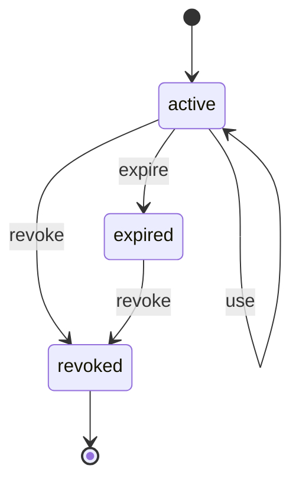

### channel-image-upload

`CHANNEL_IMAGE_UPLOAD`, defined in `packages/universal/domain-rules/src/channels/channel-image-upload.machine.ts`.

Initial: `issued`. Final: `purged`.

| Event | From | To | Recorded as |
| --- | --- | --- | --- |
| `queue` | `issued` | `queued` | - |
| `commit` | `queued` | `ready` | - |
| `supersede` | `queued` | `superseded` | - |
| `fail` | `issued`, `queued` | `failed` | - |
| `purge` | `issued`, `failed`, `superseded`, `ready` | `purged` | - |

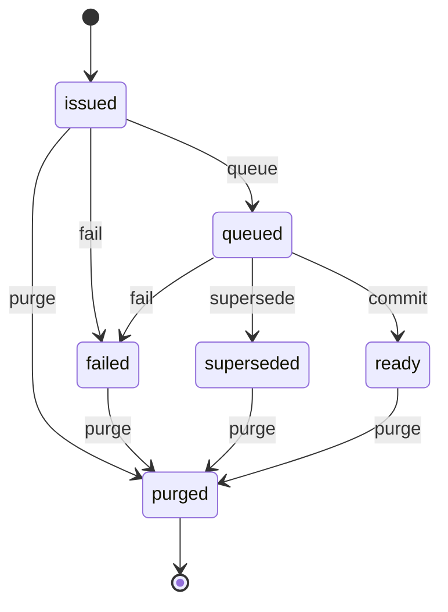

### channel-invite

`CHANNEL_INVITE`, defined in `packages/universal/domain-rules/src/channel-team/channel-invite.machine.ts`.

Initial: `pending`. Final: `accepted`, `declined`, `revoked`, `expired`.

| Event | From | To | Recorded as |
| --- | --- | --- | --- |
| `accept` | `pending` | `accepted` | - |
| `decline` | `pending` | `declined` | - |
| `revoke` | `pending` | `revoked` | - |
| `expire` | `pending` | `expired` | - |

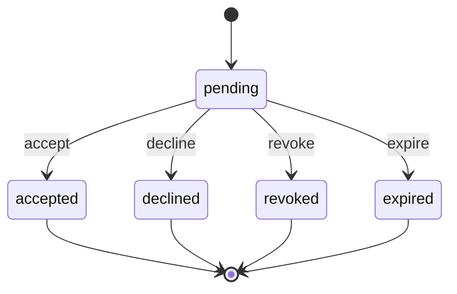

### comment-moderation

`COMMENT_MODERATION`, defined in `packages/universal/domain-rules/src/comments/comment-moderation.machine.ts`.

Initial: `published`, `held`. Final: `removed`.

| Event | From | To | Recorded as |
| --- | --- | --- | --- |
| `hold` | `published` | `held` | - |
| `approve` | `held` | `published` | - |
| `hide` | `published` | `hidden` | - |
| `unhide` | `hidden` | `published` | - |
| `remove` | `published`, `held`, `hidden` | `removed` | - |

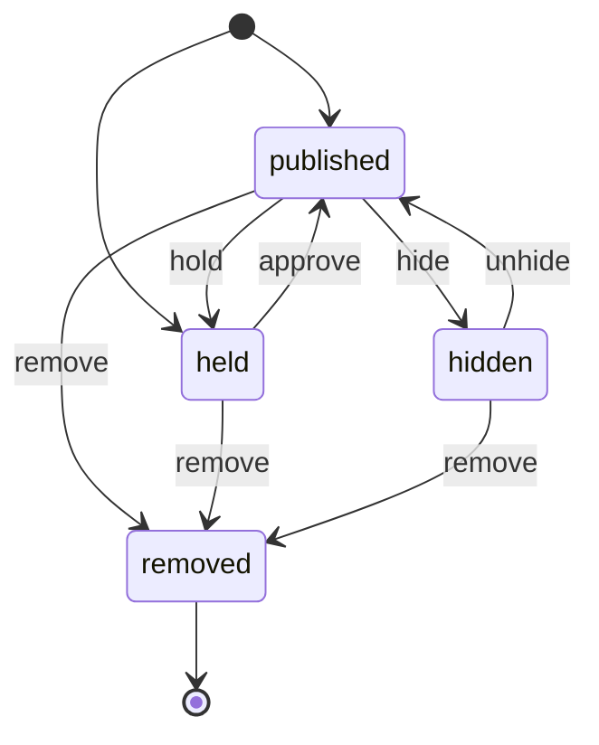

### data-export

`DATA_EXPORT`, defined in `packages/universal/domain-rules/src/exports/data-export.machine.ts`.

Initial: `queued`. Final: `failed`, `expired`.

| Event | From | To | Recorded as |
| --- | --- | --- | --- |
| `start` | `queued`, `running` | `running` | - |
| `finish` | `running` | `ready` | - |
| `fail` | `queued`, `running` | `failed` | - |
| `expire` | `ready` | `expired` | - |

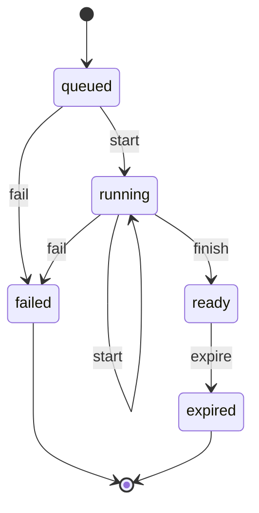

### dlq-entry

`DLQ_ENTRY`, defined in `packages/universal/domain-rules/src/dlq/dlq-entry.machine.ts`.

Initial: `PARKED`. Final: `REPLAYED`, `DISCARDED`.

| Event | From | To | Recorded as |
| --- | --- | --- | --- |
| `replay` | `PARKED` | `REPLAYED` | - |
| `discard` | `PARKED` | `DISCARDED` | - |

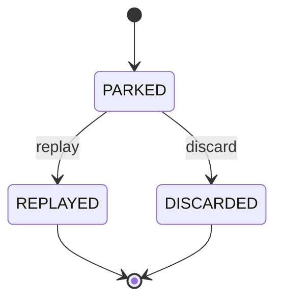

### experiment

`EXPERIMENT`, defined in `packages/universal/domain-rules/src/experiments/experiment.machine.ts`.

Initial: `running`. Final: `finished`, `stopped`.

| Event | From | To | Recorded as |
| --- | --- | --- | --- |
| `apply` | `running` | `finished` | - |
| `stop` | `running` | `stopped` | - |

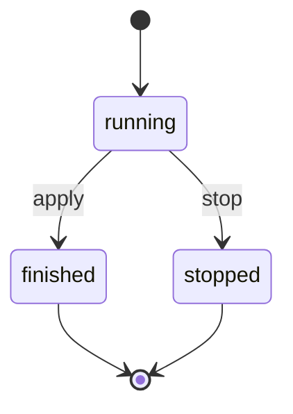

### live-stream

`LIVE_STREAM`, defined in `packages/universal/domain-rules/src/live/live-stream.machine.ts`.

Initial: `IDLE`. Final: `ENDED`.

| Event | From | To | Recorded as |
| --- | --- | --- | --- |
| `goLive` | `IDLE` | `LIVE` | - |
| `end` | `LIVE` | `ENDED` | - |
| `requestStop` | `LIVE` | `LIVE` | - |

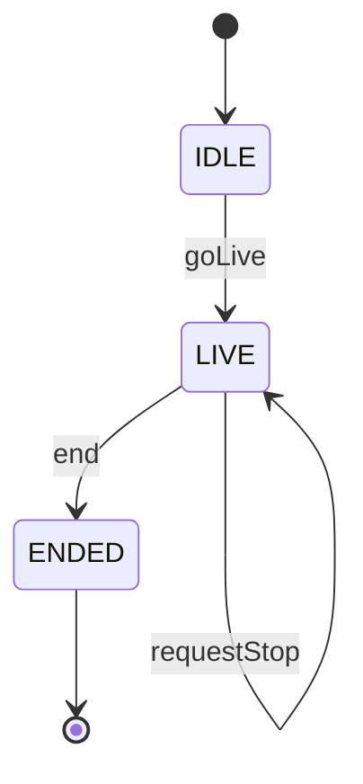

### outbox-row

`OUTBOX_ROW`, defined in `packages/universal/domain-rules/src/outbox/outbox-row.machine.ts`.

Initial: `PENDING`. Final: `PUBLISHED`, `DEAD`.

| Event | From | To | Recorded as |
| --- | --- | --- | --- |
| `publish` | `PENDING` | `PUBLISHED` | - |
| `retry` | `PENDING` | `PENDING` | - |
| `bury` | `PENDING` | `DEAD` | - |

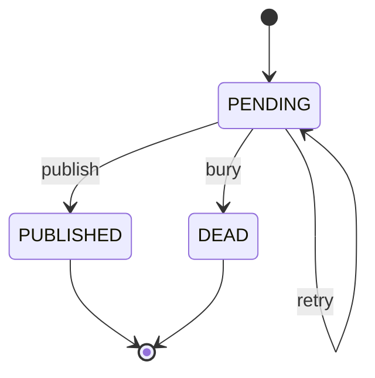

### post-lifecycle

`POST_LIFECYCLE`, defined in `packages/universal/domain-rules/src/posts/post-lifecycle.machine.ts`.

Initial: `draft`, `scheduled`, `published`. Final: `published`.

| Event | From | To | Recorded as |
| --- | --- | --- | --- |
| `schedule` | `draft` | `scheduled` | - |
| `publish` | `draft`, `scheduled` | `published` | - |

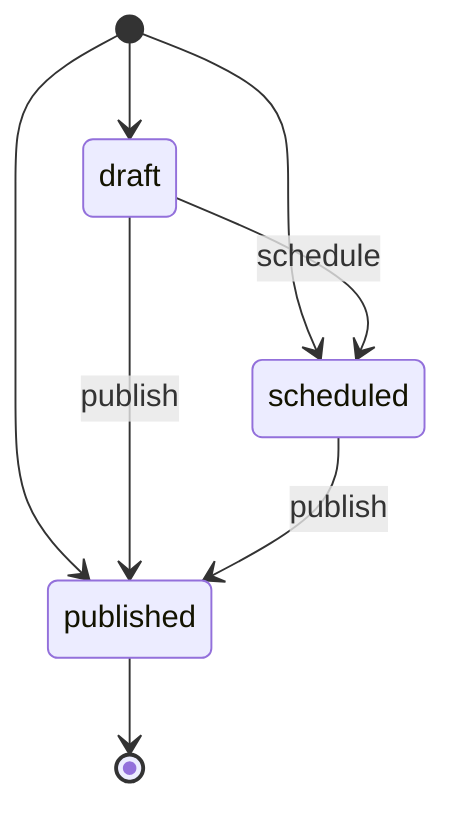

### upload-session

`UPLOAD_SESSION`, defined in `packages/universal/domain-rules/src/uploads/upload-session.machine.ts`.

Initial: `OPEN`. Final: `COMPLETED`, `ABORTED`.

| Event | From | To | Recorded as |
| --- | --- | --- | --- |
| `complete` | `OPEN` | `COMPLETED` | - |
| `abort` | `OPEN` | `ABORTED` | - |

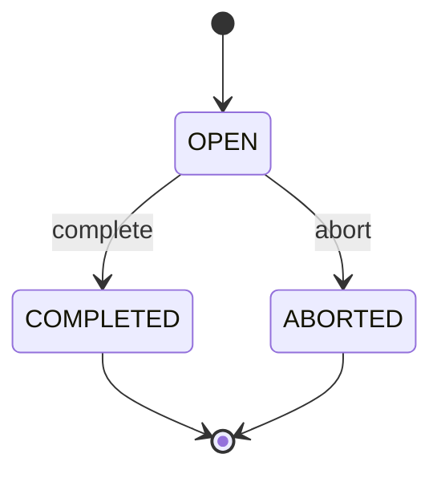

### video-edit

`VIDEO_EDIT`, defined in `packages/universal/domain-rules/src/video-pipeline/video-edit.machine.ts`.

Initial: `rendering`. Final: none.

| Event | From | To | Recorded as |
| --- | --- | --- | --- |
| `render` | `applied`, `failed`, `reverted` | `rendering` | - |
| `apply` | `rendering` | `applied` | - |
| `fail` | `rendering` | `failed` | - |
| `revert` | `applied` | `reverted` | - |

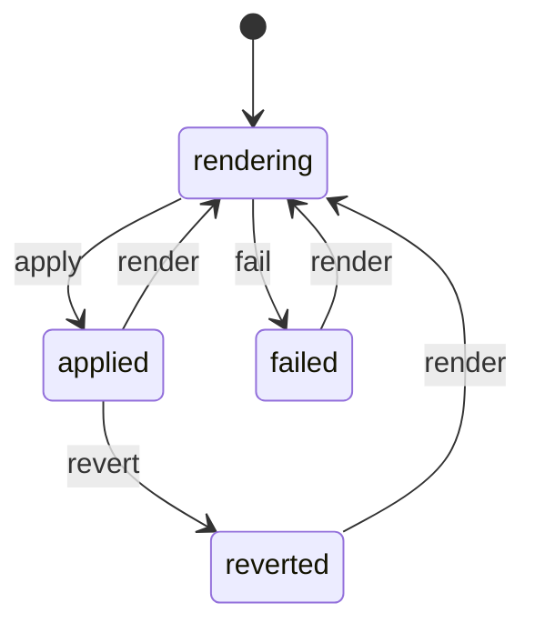

### video-generation

`VIDEO_GENERATION`, defined in `packages/universal/domain-rules/src/video-pipeline/video-generation.machine.ts`.

Initial: `uploading`, `rendering`, `retired`. Final: `failed`, `purged`.

| Event | From | To | Recorded as |
| --- | --- | --- | --- |
| `render` | `uploading` | `rendering` | - |
| `swap` | `rendering` | `active` | - |
| `fail` | `uploading`, `rendering` | `failed` | - |
| `retire` | `active` | `retired` | - |
| `restore` | `retired` | `active` | - |
| `purge` | `retired` | `purged` | - |

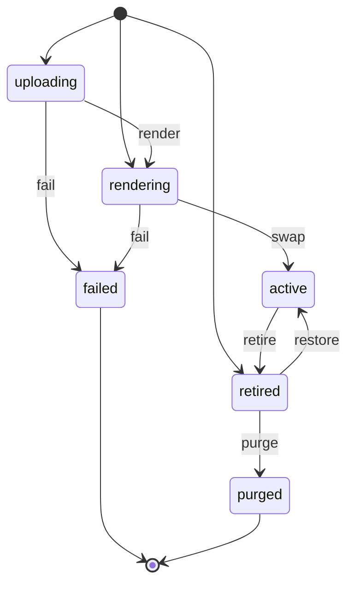

### video-lifecycle

`VIDEO_LIFECYCLE`, defined in `packages/universal/domain-rules/src/videos/video-lifecycle.machine.ts`.

Initial: `UPLOADING`, `LIVE`. Final: `DELETED`.

| Event | From | To | Recorded as |
| --- | --- | --- | --- |
| `reject` | `UPLOADING` | `REJECTED` | `upload.rejected` |
| `complete` | `UPLOADING` | `UPLOADED` | `upload.completed` |
| `abort` | `UPLOADING` | `ABANDONED` | `upload.aborted` |
| `abandon` | `UPLOADING` | `ABANDONED` | `video.abandoned` |
| `startProbe` | `UPLOADED` | `PROBING` | `probe.started` |
| `completeProbe` | `PROBING` | `PROCESSING` | `probe.completed` |
| `failProbe` | `PROBING` | `FAILED` | `video.failed` |
| `completeThumbnail` | `PROCESSING` | `PROCESSING` | `thumbnail.completed` |
| `package` | `PROCESSING` | `READY` | `video.ready` |
| `fail` | `PROCESSING`, `PROBING` | `FAILED` | `video.failed` |
| `reconcileFail` | `PROBING`, `PROCESSING` | `FAILED` | `video.failed` |
| `reprocess` | `READY`, `FAILED`, `PROCESSING` | `PROBING` | `video.reprocessing` |
| `delete` | `UPLOADING`, `UPLOADED`, `PROBING`, `PROCESSING`, `READY`, `HELD`, `FAILED`, `REJECTED`, `ABANDONED` | `DELETED` | `video.deleted` |
| `takedown` | `UPLOADING`, `UPLOADED`, `PROBING`, `PROCESSING`, `READY`, `HELD`, `FAILED`, `REJECTED`, `ABANDONED` | `REJECTED` | `video.taken_down` |
| `finalizeLive` | `LIVE` | `READY` | `video.ready` |
| `failLive` | `LIVE` | `FAILED` | `video.failed` |
| `hold` | `PROCESSING` | `HELD` | `video.held` |
| `approve` | `HELD` | `PROCESSING` | `video.screening_approved` |
| `rejectScreening` | `HELD` | `REJECTED` | `video.screening_rejected` |
| `appeal` | `REJECTED` | `HELD` | `video.screening_appealed` |

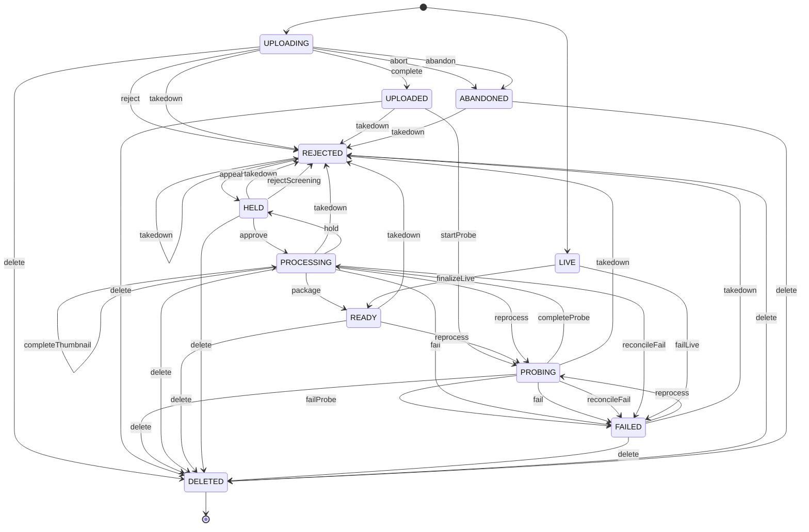

## Backlog

Not done yet, ranked by value over cost (S up to a day, M two or three days, L a week). Each one changes behaviour or needs a design call or an integration run first.

1. **S9b. A child failure never reaches the package failure handler in production (M).** BullMQ fails a parent through `failParentOnFailure` inside Lua, so the worker never emits `failed` for it and the video waits for `reconcile-processing` (3 h). The in-memory queue calls the handler anyway, which is why the flow spec passes. The failure handler's package FAILED transition and the screening HELD path are also not fenced by generation, and `bullmq-processor.ts` keeps its own copy of the unknown-error attempt cap.
2. **S1e. Remove the pair form of `transition` (S).** The API and the screening repositories name an edge; the worker call sites in `failure-handler`, `probe*` and `reconcile-*` still write `from` and `to`, which resolve to the first matching edge.
3. **S7b. Expired OPEN uploads and the COMPLETED upload with an UPLOADING video (M).** An OPEN upload whose video left UPLOADING another way, or a crash between the two writes, has no recovery path. It needs a scan port on the upload repository.
4. **S12, S13. Watch-party room phase (M).** Drop the duplicated `phase`, give a closed room a phase, make the clock exhaustive. Then the two socket booleans on the server.
5. **S14. SSE connection booleans to one union (M).** Five booleans give 32 combinations for about 8 real states. Timers are involved, so it needs its own plan.
6. **C6, C13. Client status display reads one "watchable" concept (M).** About 8 literal status comparisons in the studio, the web app and the embed route mean "watchable" or "processing". A named predicate in `@vp/domain-rules` replaces them, and the live pages follow. The stale progress tick on a READY video is fixed.
7. **C11, C17, C18. Composer, settings sections, table state (S).** The `saved = isSuccess && !dirty` idiom is repeated 7 times, and `fetching = isFetching && !isPending` in 7 tables.
8. **C9, C10, C1, C8. Replay intent, PWA, preferences merge, playback host (L).** High blast radius, 12 or more files each, and their specs overlap the flaky-spec work.
