# Tickets — video-pipeline

Tracer-bullet tickets generated from [`PRD.md`](../PRD.md) and [`SDD.md`](../SDD.md) following the `to-tickets` method (Matt Pocock's skills library): each ticket is a **vertical slice** that is demoable on its own and sized for one fresh agent context window; numbering is **dependency order** (blockers have lower numbers), not priority, with one exception: a foundation ticket added after the tickets that build on it keeps the next free number and blocks them anyway, so the graph may point from a higher number to a lower one but never in a cycle. Each ticket's `Blocked by` row is authoritative; the `Blocks` rows, the frontier, the status board, the graph and the lanes below are generated from it by `python3 docs/tickets/gen-index.py` (which also validates every PRD/SDD anchor the tickets link to). The same run derives `blocked` and `ready` from the blockers and writes them into each ticket's `**Status:**` line. Only `in-progress` and `done` are set by hand (plus `blocked-by-date` on a ticket waiting for a date, which falls back to `blocked` while a blocker is open), so change one of those and re-run to update the board.

## Frontier

Every ticket whose blockers are all `done` and which nobody has started, computed from the `**Status:**` lines.

- [48: Complete monorepo rebrand & package namespace unification (@vp/ -> @taitube/, services, Docker & CLI)](48-project-rebrand-cli-unification.md)
- [123: Parallel Studio upload parts and an atomic view and retention flush](123-parallel-studio-upload-and-atomic-retention-flush.md)
- [124: Related videos payload, one round trip less on report resolution, and removing the unused field filter](124-related-videos-payload-and-unused-field-filter-removal.md)
- [125: Viewer activity - search history, liked videos and my comments](125-viewer-activity-search-history-likes-comments.md)
- [130: Faster CI, measured one change at a time](130-faster-ci-measured-one-change-at-a-time.md)

## How to work a ticket (humans and agents)

1. Pick a ticket from the [frontier](#frontier). Prefer the lowest number in the current phase; parallel work is fine across lanes.
2. Read the ticket, then **only** the PRD/SDD sections it links. Do not read the whole SDD — the links are the context budget.
3. Create a branch `ticket/NN-slug`. Implement the *whole* slice: schema → code → tests → docs. Keep `.env.example`, `packages/job-contracts` and the SDD in sync if you touch them (the drift tests will tell you).
4. Every acceptance criterion becomes a test or a recorded demo (screenshot/GIF/result table in the PR).
5. PR checklist & Definition of Done:
   - All AC ticked with verifiable evidence.
   - Tests green under Node **and** Bun where the worker or shared packages are involved.
   - **Branch Protection, PR-Only Merges with Required Approval & Green CI in DoD:** Direct push to `main` is blocked. All changes must be made on `ticket/NN-slug`, opened as a GitHub Pull Request, reviewed with comments on the PR, and merged only after receiving at least one required review approval and all CI workflow checks (`lint-typecheck`, `unit`, `unit-bun`, `integration`, `e2e-smoke`) pass green on GitHub Actions.
   - **Persistent Agent Loop:** Implementor and reviewer agents remain active throughout the PR review-fix loop to evaluate feedback, push fixes or reply with rationale, and verify until approved.
   - **Optimal Execution & Zero-Waste Efficiency in DoD:** All workflows, Docker builds, CI steps, test suites, and local setup scripts MUST be optimized for speed, minimal resource consumption, and rapid feedback loops (Docker Buildx layer caching, sub-second linting, incremental typechecks, ultra-short test fixtures). Never introduce un-cached heavy operations or regressions in cycle time.
   - No new external runtime dependency (local-first, SDD P9 / PRD G11).
   - **Documentation, Architecture & README in DoD:** `README.md`, `ARCHITECTURE.md`, and `docs/SDD.md` (and relevant ADRs) MUST be updated if any feature, command, boundary, contract, workspace package, schema, or architecture decision is added or changed. Keep `README.md` accurate, professional, human-written, and continuously improved.
   - Ticket `**Status:**` set to `done`, `python3 docs/tickets/gen-index.py` re-run, and changes synced to GitHub Issues / Project board via CI or `pnpm sync:tickets`.
6. Found a decision the ticket doesn't cover? Don't guess silently: pick the option most consistent with the SDD ADRs, write it into the ticket's *Open questions* as "Decided: …", and flag it in the PR.

**Sizes:** S ≈ half a session · M ≈ one session · L ≈ one long session (still one context window if you follow the links only).

## Status board

| # | Ticket | Phase | Size | Blocked by | Blocks | Status |
|---|---|---|---|---|---|---|
| 01 | [Repo skeleton + local infrastructure (`make up && pnpm test` green on a fresh clone)](01-repo-skeleton-local-infra.md) | 0 | M (one focused session) | — | 02, 03, 04, 31, 48 | done |
| 02 | [CI with real service containers, Node and Bun test jobs, Renovate](02-ci-dual-runtime.md) | 0 | M | 01 | 08, 80 | done |
| 03 | [Dev tooling — deterministic video fixtures, dev JWT issuer, hls.js test page](03-dev-tooling-fixtures-token-testpage.md) | 0 | M | 01 | 04, 06 | done |
| 04 | [API skeleton + auth + full database schema — `GET /v1/videos/:id` returns a video](04-api-skeleton-auth-schema-get-video.md) | 1 | L (largest foundation slice; still one session if the DDL is copied from the SDD) | 01, 03 | 05, 10, 15, 19, 37, 38 | done |
| 05 | [Upload slice — single presigned PUT → complete + verify → `UPLOADED` → `probe` job enqueued](05-single-put-upload-complete-enqueue.md) | 1 | M | 04 | 06, 11, 109, 115, 116 | done |
| 06 | [Worker runtime + `probe` stage — good files become `PROCESSING`, hostile files become `FAILED`](06-worker-runtime-probe-stage.md) | 1 | L | 05, 03 | 07, 17, 111 | done |
| 07 | [`transcode-720p` + `package` + `notify` — a video becomes `READY` and plays in the test page](07-transcode-720p-package-notify-playable.md) | 1 | L | 06 | 08, 09, 12, 15 | done |
| 08 | [Containerise everything — `make up-all && make smoke` from a fresh clone (Phase 1 exit)](08-containerise-compose-smoke-images.md) | 1 | M | 07, 02 | 21, 25, 34, 35, 80 | done |
| 09 | [Crash safety — kill a worker mid-transcode; the video still becomes `READY` exactly once](09-crash-safety-effectively-once.md) | 1 | S–M | 07 | — | done |
| 10 | [Bull Board queue UI behind admin auth](10-bull-board-admin-auth.md) | 1 | S | 04 | 16 | done |
| 11 | [Multipart upload with resume and abort — a 4 GB file survives a client crash at 50 %](11-multipart-upload-resume-abort.md) | 2 | M–L | 05 | 17, 28, 109, 116 | done |
| 12 | [Fan-out / fan-in with BullMQ Flows — 1080p / 720p / 480p renditions and a multi-variant master](12-ladder-flows-fanout-fanin.md) | 2 | L | 07 | 13, 14, 16, 22, 23, 112, 116 | done |
| 13 | [Thumbnails as a non-blocking Flow child — poster, sprite sheet and WebVTT](13-thumbnails-flow-child.md) | 2 | S–M | 12 | 20 | done |
| 14 | [Stream segments to storage while encoding — 30-minute sources with bounded disk, aligned keyframes, thread back-off](14-segment-streaming-uploader-disk-bounds.md) | 2 | M–L | 12 | 20, 107 | done |
| 15 | [Live status — workers publish progress, clients subscribe via SSE with snapshot, replay and heartbeat](15-sse-progress-events.md) | 2 | M–L | 07, 04 | 20, 36, 98 | done |
| 16 | [Retries with backoff, Dead-Letter Queue with Postgres mirror, admin replay/discard, re-process with generations](16-retries-dlq-admin-replay-reprocess.md) | 2 | L | 12, 10 | 20, 30, 116 | done |
| 17 | [Housekeeping stage — schedulers, upload/processing reconcilers, soft delete and object purge](17-housekeeping-reconciler-purge.md) | 2 | M | 11, 06 | 18, 20, 98, 109, 111, 112, 116, 120, 121 | done |
| 18 | [Admission control and priorities — one heavy user cannot starve the others](18-admission-control-priorities.md) | 2 | S | 17 | — | done |
| 19 | [Videos API completion — paginated list, metadata edits with optimistic locking, visibility, OpenAPI + contract tests](19-videos-api-completion-openapi.md) | 2 | M | 04 | 36, 50 | done |
| 20 | [Phase 2 acceptance — pipeline E2E suite with the hostile set (20 concurrent videos, all terminal in 15 min)](20-phase2-acceptance-e2e-suite.md) | 2 | M | 13, 14, 15, 16, 17 | 28 | done |
| 21 | [Local observability stack — Prometheus, Grafana, Tempo, Loki, OTel collector as a compose profile](21-observability-stack-local.md) | 3 | M | 08 | 22, 23 | done |
| 22 | [Metrics catalogue populated + queue poller + Grafana dashboards (Pipeline, Queues, Workers, API, Storage & Cost)](22-metrics-catalogue-dashboards.md) | 3 | L | 21, 12 | 24, 26, 27, 32 | done |
| 23 | [OpenTelemetry tracing end-to-end — one trace from `complete` through every worker stage](23-otel-tracing-e2e.md) | 3 | M | 21, 12 | — | done |
| 24 | [Alert rules + Alertmanager — forcing a DLQ entry pages you](24-alert-rules-alertmanager.md) | 3 | S–M | 22 | 29, 33 | done |
| 25 | [Kubernetes locally — Kustomize base + k3d overlay, Helm values; the smoke test passes on a cluster](25-kubernetes-local-k3d.md) | 3 | L | 08 | 26, 32 | done |
| 26 | [KEDA autoscaling on queue depth with safe scale-in — the 0 → N → 0 proof graph](26-keda-autoscaling-graceful-shutdown.md) | 3 | M–L | 25, 22 | 28, 111, 112 | done |
| 27 | [Compose-level autoscaler — the same control loop without Kubernetes](27-compose-autoscaler.md) | 3 | S | 22 | — | done |
| 28 | [Load tests S1–S3 (upload storm, large file, backlog burst) with thresholds, nightly smoke, results README](28-k6-s1-s3-nightly-load-smoke.md) | 3 | L | 11, 20, 26 | 29, 107 | done |
| 29 | [Chaos tooling and scenarios S4–S7 — worker kills, dependency outages, SSE fan-out, soak](29-chaos-tooling-k6-s4-s7.md) | 4 | L | 28, 24 | — | done |
| 30 | [Transactional outbox — close the DB-commit-then-enqueue window](30-transactional-outbox.md) | 4 | M | 16 | 111, 112 | done |
| 31 | [Cloud accounts + Terraform — Cloudflare (R2, DNS, Tunnel, Access), Hetzner/Oracle, Neon, Grafana Cloud](31-cloud-accounts-terraform.md) | 4 | M | 01 | 32 | done |
| 32 | [Cloud reference deployment — k3s + Neon + R2/CDN + Tunnel + Grafana Cloud; a public URL plays a video for ≤ €6.5/month](32-cloud-overlay-deploy.md) | 4 | L | 25, 22, 31 | 33 | done |
| 33 | [Cost guardrails and runbooks — budget alerts, retention, five operator runbooks](33-cost-guardrails-runbooks.md) | 4 | S–M | 32, 24 | — | done |
| 34 | [Node 26 LTS upgrade and dependency refresh (after 2026-10-28)](34-node26-upgrade-deps.md) | 4 | S | 08 | — | blocked-by-date |
| 35 | [Local-first proof — the whole system runs with zero external services and no internet (Phase 1 exit criterion)](35-local-first-offline-mode.md) | 1 | S–M | 08 | 79, 80 | done |
| 36 | [Public video feed — unauthenticated browse, detail, and SSE for public videos](36-public-video-feed-api.md) | 5 | M | 19, 15 | 49, 100, 102 | done |
| 37 | [Admin category management & public cached category API](37-admin-category-management-cached-api.md) | 5 | M | 04 | 44, 49, 50, 61 | done |
| 38 | [User & channel identity profile with universal OIDC/JWKS provider](38-user-channel-identity-universal-auth.md) | 5 | L | 04 | 39, 40, 41, 42, 43, 44, 46, 47, 49, 50, 56, 72, 76, 77, 78, 97, 104, 117, 118, 120, 129 | done |
| 39 | [Declarative RBAC & ABAC permission engine (can(user, action, resource))](39-declarative-rbac-abac-permission-engine.md) | 5 | M | 38 | 40, 41, 42, 44, 46, 61, 81, 97, 101, 103, 105, 112, 113, 117, 118, 120 | done |
| 40 | [High-throughput video reactions (likes/dislikes) & counter caching](40-high-throughput-video-reactions-counter-caching.md) | 5 | M | 38, 39 | 76, 114, 120, 125 | done |
| 41 | [Channel subscriptions & subscribed channels video feed](41-channel-subscriptions-subscriber-feed.md) | 5 | M | 38, 39 | 78, 99, 100, 113, 114, 115, 120, 121 | done |
| 42 | [Threaded video comments with keyset pagination & moderation](42-threaded-comments-keyset-pagination-moderation.md) | 5 | L | 38, 39 | 76, 99, 103, 113, 118, 120, 125 | done |
| 43 | [High-scale video views buffer (Redis batch flush) & creator studio analytics](43-high-scale-video-views-buffer-reconciler.md) | 5 | L | 38 | 44, 65, 114, 116, 118, 122, 123, 128 | done |
| 44 | [Creator studio video management (metadata, thumbnails, visibility & admin overrides)](44-creator-studio-video-management-visibility.md) | 5 | M | 37, 38, 39, 43 | 47, 60, 111, 112, 113, 114, 115, 116, 117, 122 | done |
| 45 | [Frontend API modernization & contract alignment — migrate web app to clean canonical `/v1` APIs](45-legacy-frontend-compatibility-adapter-layer.md) | 5 | L | — | — | done |
| 46 | [YouTube-grade playlists & watch history domain engine (Public/private, Watch Later, drag-and-drop reorder & resume sync)](46-youtube-playlists-watch-history-engine.md) | 5 | L | 38, 39 | 47, 73, 100, 104, 115, 119, 122, 125 | done |
| 47 | [Multi-resource search engine — unified weighted full-text search across videos, channels & playlists with Redis caching](47-multi-resource-search-engine.md) | 5 | L | 38, 44, 46 | 74, 92, 111, 125 | done |
| 48 | [Complete monorepo rebrand & package namespace unification (@vp/ -> @taitube/, services, Docker & CLI)](48-project-rebrand-cli-unification.md) | 5 | L | 01, 92, 93 | — | ready |
| 49 | [Next-Gen frontend direct API gateway & CORS profile for Taitube](49-nextgen-frontend-api-gateway-bootstrap.md) | 5 | M | 36, 37, 38 | — | done |
| 50 | [Shared API contracts package (`@taitube/api-contracts`) & automated OpenAPI TypeScript codegen](50-shared-api-contracts-zod-openapi-codegen.md) | 5 | M | 19, 37, 38 | — | done |
| 51 | [Type-safe API client SDK (`@taitube/api-client`) with auto-generated TanStack Query hooks](51-type-safe-query-client-tanstack-react-hooks.md) | 5 | M | — | — | done |
| 52 | [Frontend integration as monorepo app (`apps/web`) with shared contracts & unified DX](52-integrate-frontend-pnpm-monorepo-app-web.md) | 5 | L | — | — | done |
| 53 | [Frontend data layer on TanStack Query and TanStack Form - loaders, query options, RTK Query removed](53-frontend-architecture-modernization-tanstack-query.md) | 5 | L | 89, 91 | 56, 58, 59, 60, 61, 68, 70, 72, 92, 93, 98 | done |
| 54 | [Frontend testing infrastructure & integration suite (Vitest, Testing Library & MSW mock API)](54-frontend-testing-trophy-vitest-msw-integration-suite.md) | 5 | M | 89, 91 | 55, 56, 92, 93, 95 | done |
| 55 | [Modern design system foundation — Tailwind CSS v4, Radix UI primitives & theme engine](55-design-system-tailwind-radix-dark-theme.md) | 5 | L | 54, 89, 91 | 57, 58, 59, 60, 61, 69, 70, 72, 92, 93, 95 | done |
| 56 | [Frontend universal auth, session security & XSS / token hardening](56-frontend-universal-auth-session-security.md) | 5 | M | 38, 53, 54, 89, 91, 93 | 60, 61, 62, 72, 129 | done |
| 57 | [Production video player — YouTube-grade player (Video.js 10, Ambient Glow, Storyboard Scrubbing, Cinema & Stats for Nerds)](57-production-video-player-hls-streaming-controls.md) | 5 | L | 55, 75, 89, 91, 93 | 59, 62, 65, 66, 73, 76, 77, 78, 102, 105, 111, 116, 119, 120, 122 | done |
| 58 | [Modern browse layout — responsive navigation, category pills & video card micro-interactions](58-modern-browse-layout-microinteractions-motion.md) | 5 | L | 53, 55, 89, 91, 93 | 62, 63, 74, 96, 100, 101, 102, 106, 115, 120, 121, 126 | done |
| 59 | [Modern video watch page — dynamic 2-column layout, interactive engagement bar & threaded comments UI](59-video-watch-page-responsive-layout-enhancements.md) | 5 | L | 53, 55, 57, 89, 91, 95 | 62, 63, 73, 76, 105, 106, 113, 114, 116, 119, 120, 122 | blocked |
| 60 | [Creator studio dashboard — video library, analytics charts & upload modal](60-creator-studio-dashboard-video-management-ui.md) | 5 | L | 44, 53, 55, 56, 89, 91, 93, 95 | 62, 66, 112, 113, 114, 116, 118, 128 | blocked |
| 61 | [Administrator control panel — dynamic category manager, queue health & moderation UI](61-admin-control-panel-category-moderation-ui.md) | 5 | M | 37, 39, 53, 55, 56, 89, 91, 93, 95 | 101, 112 | blocked |
| 62 | [Remove the legacy frontend and virtualize long lists](62-frontend-performance-virtualization-ssr-bundle-hardening.md) | 5 | L | 56, 57, 58, 59, 60, 74, 89, 91, 95 | — | blocked |
| 63 | [Video SEO on the SSR render - route meta, OpenGraph, player cards, JSON-LD, sitemap and RSS](63-tanstack-router-start-ssr-seo-streaming.md) | 5 | M | 58, 59, 89, 91 | 77, 86 | blocked |
| 64 | [Core Web Vitals real-user measurement (LCP, INP, CLS) and OpenTelemetry web traces](64-web-vitals-monitoring-inp-lcp-cls-real-user-measurement.md) | 5 | M | 89, 91, 93 | 65 | done |
| 65 | [First-party video playback telemetry, QoS & creator audience analytics beacon](65-first-party-video-playback-telemetry-analytics-beacon.md) | 5 | M | 43, 57, 64, 89, 91, 93 | 114, 116, 118, 122, 123, 126, 128 | done |
| 66 | [Advanced code splitting, granular chunking & asset lazy loading](66-advanced-code-splitting-dynamic-chunking-lazy-loading.md) | 5 | M | 57, 60, 89, 91 | — | blocked |
| 67 | [Intelligent pre-fetching, viewport-triggered queries & Service Worker asset cache](67-intelligent-prefetch-lazy-fetching-service-worker-cache.md) | 5 | M | — | — | done |
| 68 | [Progressive Web App (PWA) & Service Worker — offline experience, asset caching & background sync](68-pwa-service-worker-offline-cache-background-sync.md) | 5 | L | 53, 89, 91, 93, 95 | — | blocked |
| 69 | [Frontend URL-driven state architecture — search params sync, modal deep-linking (STS pattern) & typesafe routing](69-frontend-url-state-search-params-modal-routing.md) | 5 | M | 55, 89, 91, 93, 95 | 73 | blocked |
| 70 | [Frontend resilient error handling — RFC 9457 error pages, classified query retry policies & contextual view fallbacks](70-frontend-resilient-error-handling-retry-policy.md) | 5 | M | 53, 55, 89, 91, 93, 95 | — | blocked |
| 71 | [Frontend skeleton shimmer loading states — layout-stable placeholders for primary views (CLS < 0.05)](71-frontend-skeleton-shimmer-loading-states.md) | 5 | M | — | — | done |
| 72 | [Settings - a full settings area with appearance, advanced token sets, accessibility, playback, privacy and notifications, saved to the device and the account](72-frontend-settings-customization-system.md) | 5 | L | 38, 53, 55, 56, 89, 91, 93, 95, 97, 104 | 86, 96, 106, 115, 121, 126, 129 | blocked |
| 73 | [Frontend YouTube-grade playlist & watch history library — watch history feed, playlist manager & player queue](73-frontend-youtube-playlists-library-player-queue.md) | 5 | L | 46, 57, 59, 69, 89, 91, 95, 125 | 115, 119 | blocked |
| 74 | [Frontend multi-resource search & discovery UI — polymorphic results, filter chips & auto-complete suggestions](74-frontend-multi-resource-search-discovery-ui.md) | 5 | M | 47, 58, 89, 91, 95, 125 | 62 | blocked |
| 75 | [Full-stack Playwright E2E suite, security validation & end-to-end performance benchmarking](75-fullstack-e2e-playwright-security-perf-validation.md) | 5 | L | 89 | 57, 92, 93 | done |
| 76 | [Live streaming architecture — RTMP/WHIP ingestion, low-latency HLS packaging & real-time chat sidecar](76-live-streaming-rtmp-whip-llhls-packaging-chat.md) | 5 | L | 38, 40, 42, 57, 59, 93, 98 | 78, 121, 122 | blocked |
| 77 | [Platform integrations ecosystem — oEmbed provider, embeddable iframe player, Discord/Twitter rich unfurls & webhooks](77-platform-integrations-oembed-embed-player-webhooks.md) | 5 | M | 38, 57, 63, 89 | 78, 118 | blocked |
| 78 | [Discord integration ecosystem — Taitube Discord bot, Watch Together voice activity, creator alerts & community role sync](78-discord-integration-bot-watch-together-activity-creator-alerts.md) | 5 | L | 38, 41, 57, 76, 77, 89, 93 | — | blocked |
| 79 | [Offline smoke test runner refactor & CI configuration cleanup](79-offline-smoke-runner-refactor-cleanup.md) | 1 | S | 35 | — | done |
| 80 | [Full-spectrum developer experience, local environment setup & CI/CD pipeline acceleration](80-ci-test-pipeline-optimization-speed.md) | 3 | L | 02, 08, 35 | — | done |
| 81 | [Declarative permissions refactor with @casl/ability & elimination of ad-hoc checks](81-casl-declarative-permissions-refactor.md) | 5 | M | 39 | 82, 108, 117 | done |
| 82 | [Architecture remediation — package runtime tiers, contract seams & machine-enforced boundaries](82-architecture-remediation-package-scoping-contract-seams.md) | 5 | L | 81 | 83, 84 | done |
| 83 | [Granular container topology — per-app images, a one-app dev loop and a single orchestrated launch](83-granular-container-topology-full-stack-deployment.md) | 5 | L | 82 | 92, 93 | done |
| 84 | [Result-typed error handling — domain code returns, the edge decides](84-result-typed-error-handling-shared-domain-rules.md) | 5 | L | 82 | 85, 87 | done |
| 85 | [Universal `Intl` formatting core — global formatters, typed placeholders & message catalogues](85-universal-intl-formatting-message-core.md) | 5 | L | 84 | 86, 89 | done |
| 86 | [Localisation rollout — locale negotiation, a second language, SSR locale & RTL](86-localisation-rollout-locale-negotiation-rtl.md) | 5 | M | 63, 72, 85, 89, 91, 95 | 115, 121 | blocked |
| 87 | [One composition root — a typed container, configuration as a value, and no hidden dependencies](87-composition-root-typed-container-config-value.md) | 5 | L | 84 | 88 | done |
| 88 | [Codebase health to nine: every scorecard dimension at 9+, each one held by a ratchet](88-codebase-health-ratchets.md) | 5 | XL (delivered as six PRs, see *Delivery*) | 87 | 89, 90 | done |
| 89 | [Move apps/web from Create React App to TanStack Start - Vite, file-based TanStack Router, TanStack Query and SSR](89-web-tanstack-start-foundation.md) | 5 | L | 85, 88 | 53, 54, 55, 56, 57, 58, 59, 60, 61, 62, 63, 64, 65, 66, 68, 69, 70, 72, 73, 74, 75, 77, 78, 86, 91, 95 | done |
| 90 | [Cloud Terraform on the Cloudflare v5 provider, validated in CI](90-cloud-terraform-provider-v5.md) | 5 | M | 88 | — | done |
| 91 | [Web app imports on `#app/` subpath imports - no `src/` alias, no deep relative paths](91-web-import-aliases.md) | 5 | S | 89 | 53, 54, 55, 56, 57, 58, 59, 60, 61, 62, 63, 64, 65, 66, 68, 69, 70, 72, 73, 74, 86, 95 | done |
| 92 | [Group apps by tier: apps/server and apps/client](92-apps-grouped-by-tier.md) | 5 | M | 47, 53, 54, 55, 75, 83 | 48, 93 | done |
| 93 | [Creator Studio as its own app (apps/client/studio), served and deployed separately](93-creator-studio-separate-app.md) | 5 | L | 92, 53, 54, 55, 75, 83 | 48, 56, 57, 58, 60, 61, 64, 65, 68, 69, 70, 72, 76, 78, 95, 109, 117 | done |
| 94 | [TypeScript 7 native toolchain for typecheck and build](94-typescript-7-native-toolchain.md) | 5 | S | — | — | blocked-by-date |
| 95 | [Design system 2 - themes and swappable token sets, shared option types, primitives, components and a workbench](95-design-system-2.md) | 5 | XL (stack 1, slices a to q, then one PR r in three parts, see *Delivery*) | 54, 55, 89, 91, 93, 97 | 59, 60, 61, 62, 68, 69, 70, 72, 73, 74, 86, 96, 99, 102, 103, 106, 110, 113, 114, 115, 116, 117, 118, 119, 120, 121, 122, 126, 128, 129 | in-progress |
| 96 | [Channel featured videos - creators pin the Start here shelf](96-channel-featured-videos-start-here.md) | 5 | M | 58, 72, 95 | 121 | blocked |
| 97 | [Saved preferences - one account endpoint for appearance, playback, privacy and notifications](97-account-preferences-api.md) | 5 | M | 38, 39 | 72, 95, 99, 111, 125 | done |
| 98 | [Realtime - one typed user event stream over SSE, shared across tabs, feeding the query cache](98-realtime-user-event-stream.md) | 5 | M | 15, 17, 53 | 76, 99, 103, 111, 112, 113, 114, 118, 119, 120, 129 | done |
| 99 | [Notifications - model, producers, API and the live bell](99-notifications.md) | 5 | L | 41, 42, 95, 97, 98 | 112, 113, 117, 119, 120, 122, 129 | in-progress |
| 100 | [Home shelves with reasons, related videos and viewer progress on every card](100-home-shelves-related-videos.md) | 5 | L | 36, 41, 46, 58 | 124, 126 | done |
| 101 | [Pick of the day - editors schedule the home spotlight](101-pick-of-the-day-curation.md) | 5 | M | 39, 58, 61 | — | blocked |
| 102 | [Shorts - vertical videos classified at probe, their own feed and the /shorts player](102-shorts.md) | 5 | L | 36, 57, 58, 95 | 121, 122 | blocked |
| 103 | [Comments - creator hearts, reports and the creator's comment inbox](103-comment-hearts-reports-creator-inbox.md) | 5 | M | 39, 42, 95, 98 | 112, 113, 120 | in-progress |
| 104 | [Channel page data - public playlists, About links and channel stats](104-channel-page-data.md) | 5 | S | 38, 46 | 72, 115, 119, 121 | done |
| 105 | [Clips - share a moment of a video as its own link](105-clips.md) | 5 | M | 39, 57, 59 | 116, 119, 122 | blocked |
| 106 | [Themes beyond the built-ins - a channel's brand colour and a viewer's own theme](106-channel-branded-and-user-built-themes.md) | 5 | M | 58, 59, 72, 95 | 121 | blocked |
| 107 | [Chunked parallel transcoding of long sources](107-chunked-parallel-transcoding-and-hardware-acceleration.md) | 5 | L | 14, 28 | 111 | done |
| 108 | [End-to-end single-source ABAC - field-level permission filter](108-end-to-end-single-source-abac-sql-pushdown-and-field-filtering.md) | 5 | S | 81 | 124 | done |
| 109 | [Upload lifecycle hardening - idempotent abort, part sizing, and Studio cancel](109-upload-lifecycle-hardening-and-leak-prevention.md) | 5 | M | 05, 11, 17, 93 | 123 | done |
| 110 | [Oxc and Vite+ toolchain - oxlint, oxfmt, Vite Task, the Oxc React Compiler, and the memo cleanup it allows](110-oxc-vite-plus-toolchain.md) | 5 | L | 95 | — | blocked |
| 111 | [Captions and transcripts - local speech-to-text on its own queue, side-loaded WebVTT, creator and viewer controls](111-captions-and-transcripts.md) | 5 - Developer experience & growth | L | 06, 17, 26, 30, 44, 47, 57, 97, 98, 107 | 112, 116 | in-progress |
| 112 | [Upload screening - local duplicate, content-safety and rule checks that hold a video for review](112-upload-screening.md) | 5 - Developer experience & growth | L | 12, 17, 26, 30, 39, 44, 60, 61, 98, 99, 103, 111 | — | blocked |
| 113 | [Channel comment moderation - hold for review, blocked words, slow mode, silent or visible actions, bans and a moderation queue](113-channel-comment-moderation.md) | 5 - Developer experience & growth | L | 39, 41, 42, 44, 59, 60, 95, 98, 99, 103, 117 | 114, 116, 118, 120, 122 | blocked |
| 114 | [Creator stats on the watch page - the numbers and quick actions for the people who run the channel](114-creator-stats-on-the-watch-page.md) | 5 - Developer experience & growth | L | 40, 41, 43, 44, 59, 60, 65, 95, 98, 113, 117 | 128 | blocked |
| 115 | [Channel identity - banner and avatar upload, handle change, trailer, links and series](115-channel-page-customisation.md) | 5 - Developer experience & growth | L | 05, 41, 44, 46, 58, 72, 73, 86, 95, 104, 117 | 119, 120, 121, 122 | blocked |
| 116 | [Video management power tools - bulk edit, history, replace file, corrections, share links, passwords, tests, chapters, trim and clip suggestions](116-video-management-power-tools.md) | 5 - Developer experience & growth | XL (one stack of three slices, see *Delivery*) | 05, 11, 12, 16, 17, 43, 44, 57, 59, 60, 65, 95, 105, 111, 113, 117 | 119, 120, 121, 122 | blocked |
| 117 | [Channel team roles - invite managers, editors, moderators and analytics viewers](117-channel-team-roles.md) | 5 - Developer experience & growth | L | 38, 39, 44, 81, 93, 95, 99 | 113, 114, 115, 116, 118, 120, 121, 122, 129 | blocked |
| 118 | [Creator data portability and API - exports, personal access tokens and a developer page](118-creator-data-portability-and-api.md) | 5 - Developer experience & growth | L | 38, 39, 42, 43, 60, 65, 77, 95, 98, 113, 117 | — | blocked |
| 119 | [Playlists and lists - collaboration, segments, sections, smart playlists, watch lists, import and export](119-playlists-customisation-and-collaboration.md) | 5 - Developer experience & growth | XL (one stack of three slices, see *Delivery*) | 46, 57, 59, 73, 95, 98, 99, 104, 105, 115, 116 | 121, 122 | blocked |
| 120 | [Community - channel posts, polls and quizzes, and timestamped viewer threads](120-community-posts-and-threads.md) | 5 - Developer experience & growth | XL (one stack of three slices, see *Delivery*) | 17, 38, 39, 40, 41, 42, 57, 58, 59, 95, 98, 99, 103, 113, 115, 116, 117 | 121, 122 | blocked |
| 121 | [Channel page builder - configurable sections, tabs and custom pages with drafts, scheduling and preview](121-channel-page-builder.md) | 5 - Developer experience & growth | XL (one stack of three slices, see *Delivery*) | 17, 41, 58, 72, 76, 86, 95, 96, 102, 104, 106, 115, 116, 117, 119, 120 | 122 | blocked |
| 122 | [Linked content - one typed link graph between videos, Shorts, posts, threads, playlists, clips, live and episodes](122-linked-content-graph.md) | 5 - Developer experience & growth | XL (one stack of three slices, see *Delivery*) | 43, 44, 46, 57, 59, 65, 76, 95, 99, 102, 105, 113, 115, 116, 117, 119, 120, 121 | — | blocked |
| 123 | [Parallel Studio upload parts and an atomic view and retention flush](123-parallel-studio-upload-and-atomic-retention-flush.md) | 5 - Developer experience & growth | M | 43, 65, 109 | — | ready |
| 124 | [Related videos payload, one round trip less on report resolution, and removing the unused field filter](124-related-videos-payload-and-unused-field-filter-removal.md) | 5 - Developer experience & growth | S | 100, 108 | — | ready |
| 125 | [Viewer activity - search history, liked videos and my comments](125-viewer-activity-search-history-likes-comments.md) | 5 - Developer experience & growth | M | 40, 42, 46, 47, 97 | 73, 74, 126 | ready |
| 126 | [Recommendation feedback - "Not interested", hidden channels, a "Because you searched" shelf and a rising-creators shelf](126-recommendation-feedback-and-new-shelves.md) | 5 - Developer experience & growth | L | 58, 65, 72, 95, 100, 125 | — | blocked |
| 128 | [Creator analytics that hold up - views the player really sends, a device split and a first-week benchmark](128-creator-analytics-device-split-and-benchmark.md) | 5 - Developer experience & growth | L | 43, 60, 65, 95, 114 | — | blocked |
| 129 | [Multiple accounts and channels - signed in at once, one switcher, per-tab identity](129-multiple-accounts-and-channels.md) | 5 - Developer experience & growth | XL | 38, 56, 72, 95, 98, 99, 117 | — | blocked |
| 130 | [Faster CI, measured one change at a time](130-faster-ci-measured-one-change-at-a-time.md) | 5 - Developer experience & growth | M | — | — | ready |

> `in-progress` and `done` are set by hand; the rest derive from the blockers and are written back to each ticket: `ready` = all blockers done (the frontier) · `blocked` · `blocked-by-date` (blockers done, waiting for a date the ticket names; set by hand, reset to `blocked` while a blocker is open).

## Dependency graph

```mermaid
flowchart LR
    subgraph 0_Bootstrap["0 — Bootstrap"]
        T01["01 Repo skeleton + local infrastructure"]
        T02["02 CI"]
        T03["03 Dev tooling"]
    end
    subgraph 1_Walking_skeleton["1 — Walking skeleton"]
        T04["04 API skeleton + auth + full database schema"]
        T05["05 Upload slice"]
        T06["06 Worker runtime + probe stage"]
        T07["07 transcode-720p + package + notify"]
        T08["08 Containerise everything"]
        T09["09 Crash safety"]
        T10["10 Bull Board queue UI behind admin auth"]
        T35["35 Local-first proof"]
        T79["79 Offline smoke test runner refactor & CI …"]
    end
    subgraph 2_Real_pipeline["2 — Real pipeline"]
        T11["11 Multipart upload"]
        T12["12 Fan-out / fan-in"]
        T13["13 Thumbnails as a non-blocking Flow child"]
        T14["14 Stream segments to storage while encoding"]
        T15["15 Live status"]
        T16["16 Retries"]
        T17["17 Housekeeping stage"]
        T18["18 Admission control"]
        T19["19 Videos API completion"]
        T20["20 Phase 2 acceptance"]
    end
    subgraph 3_Observe_scale["3 — Observe & scale"]
        T21["21 Local observability stack"]
        T22["22 Metrics catalogue populated + queue poll…"]
        T23["23 OpenTelemetry tracing end-to-end"]
        T24["24 Alert rules + Alertmanager"]
        T25["25 Kubernetes locally"]
        T26["26 KEDA autoscaling on queue depth"]
        T27["27 Compose-level autoscaler"]
        T28["28 Load tests S1–S3"]
    end
    subgraph 4_Resilience_cloud["4 — Resilience & cloud"]
        T29["29 Chaos tooling"]
        T30["30 Transactional outbox"]
        T31["31 Cloud accounts + Terraform"]
        T32["32 Cloud reference deployment"]
        T33["33 Cost guardrails"]
        T34["34 Node 26 LTS upgrade"]
    end
    subgraph 5_Developer_experience_growth["5 — Developer experience & growth"]
        T36["36 Public video feed"]
        T37["37 Admin category management & public cache…"]
        T38["38 User & channel identity profile"]
        T39["39 Declarative RBAC & ABAC permission engine"]
        T40["40 High-throughput video reactions"]
        T41["41 Channel subscriptions & subscribed chann…"]
        T42["42 Threaded video comments"]
        T43["43 High-scale video views buffer"]
        T44["44 Creator studio video management"]
        T45["45 Frontend API modernization & contract al…"]
        T46["46 YouTube-grade playlists & watch history …"]
        T47["47 Multi-resource search engine"]
        T48["48 Complete monorepo rebrand & package name…"]
        T49["49 Next-Gen frontend direct API gateway & C…"]
        T50["50 Shared API contracts package"]
        T51["51 Type-safe API client SDK"]
        T52["52 Frontend integration as monorepo app"]
        T53["53 Frontend data layer on TanStack Query"]
        T54["54 Frontend testing infrastructure & integr…"]
        T55["55 Modern design system foundation"]
        T56["56 Frontend universal auth"]
        T57["57 Production video player"]
        T58["58 Modern browse layout"]
        T59["59 Modern video watch page"]
        T60["60 Creator studio dashboard"]
        T61["61 Administrator control panel"]
        T62["62 Remove the legacy frontend"]
        T63["63 Video SEO on the SSR render - route meta"]
        T64["64 Core Web Vitals real-user measurement"]
        T65["65 First-party video playback telemetry"]
        T66["66 Advanced code splitting"]
        T67["67 Intelligent pre-fetching"]
        T68["68 Progressive Web App"]
        T69["69 Frontend URL-driven state architecture"]
        T70["70 Frontend resilient error handling"]
        T71["71 Frontend skeleton shimmer loading states"]
        T72["72 Settings - a full settings area"]
        T73["73 Frontend YouTube-grade playlist & watch …"]
        T74["74 Frontend multi-resource search & discove…"]
        T75["75 Full-stack Playwright E2E suite"]
        T76["76 Live streaming architecture"]
        T77["77 Platform integrations ecosystem"]
        T78["78 Discord integration ecosystem"]
        T81["81 Declarative permissions refactor"]
        T82["82 Architecture remediation"]
        T83["83 Granular container topology"]
        T84["84 Result-typed error handling"]
        T85["85 Universal Intl formatting core"]
        T86["86 Localisation rollout"]
        T87["87 One composition root"]
        T88["88 Codebase health to nine"]
        T89["89 Move apps/web from Create React App to T…"]
        T90["90 Cloud Terraform on the Cloudflare v5 pro…"]
        T91["91 Web app imports on #app/ subpath imports…"]
        T92["92 Group apps by tier"]
        T93["93 Creator Studio as its own app"]
        T94["94 TypeScript 7 native toolchain for typech…"]
        T95["95 Design system 2 - themes"]
        T96["96 Channel featured videos - creators pin t…"]
        T97["97 Saved preferences - one account endpoint…"]
        T98["98 Realtime - one typed user event stream o…"]
        T99["99 Notifications - model"]
        T100["100 Home shelves"]
        T101["101 Pick of the day - editors schedule the h…"]
        T102["102 Shorts - vertical videos classified at p…"]
        T103["103 Comments - creator hearts"]
        T104["104 Channel page data - public playlists"]
        T105["105 Clips - share a moment of a video as its…"]
        T106["106 Themes beyond the built-ins - a channel'…"]
        T107["107 Chunked parallel transcoding of long sou…"]
        T108["108 End-to-end single-source ABAC - field-le…"]
        T109["109 Upload lifecycle hardening - idempotent …"]
        T110["110 Oxc"]
    end
    subgraph 3_Developer_Velocity_Operational_Excellence["3 — Developer Velocity & Operational Excellence"]
        T80["80 Full-spectrum developer experience"]
    end
    subgraph 5_Developer_experience_growth["5 - Developer experience & growth"]
        T111["111 Captions"]
        T112["112 Upload screening - local duplicate"]
        T113["113 Channel comment moderation - hold for re…"]
        T114["114 Creator stats on the watch page - the nu…"]
        T115["115 Channel identity - banner"]
        T116["116 Video management power tools - bulk edit"]
        T117["117 Channel team roles - invite managers"]
        T118["118 Creator data portability"]
        T119["119 Playlists"]
        T120["120 Community - channel posts"]
        T121["121 Channel page builder - configurable sect…"]
        T122["122 Linked content - one typed link graph be…"]
        T123["123 Parallel Studio upload parts"]
        T124["124 Related videos payload"]
        T125["125 Viewer activity - search history"]
        T126["126 Recommendation feedback - "Not interested""]
        T128["128 Creator analytics that hold up - views t…"]
        T129["129 Multiple accounts"]
        T130["130 Faster CI"]
    end
    T01 --> T02
    T01 --> T03
    T01 --> T04
    T03 --> T04
    T04 --> T05
    T05 --> T06
    T03 --> T06
    T06 --> T07
    T07 --> T08
    T02 --> T08
    T07 --> T09
    T04 --> T10
    T05 --> T11
    T07 --> T12
    T12 --> T13
    T12 --> T14
    T07 --> T15
    T04 --> T15
    T12 --> T16
    T10 --> T16
    T11 --> T17
    T06 --> T17
    T17 --> T18
    T04 --> T19
    T13 --> T20
    T14 --> T20
    T15 --> T20
    T16 --> T20
    T17 --> T20
    T08 --> T21
    T21 --> T22
    T12 --> T22
    T21 --> T23
    T12 --> T23
    T22 --> T24
    T08 --> T25
    T25 --> T26
    T22 --> T26
    T22 --> T27
    T11 --> T28
    T20 --> T28
    T26 --> T28
    T28 --> T29
    T24 --> T29
    T16 --> T30
    T01 --> T31
    T25 --> T32
    T22 --> T32
    T31 --> T32
    T32 --> T33
    T24 --> T33
    T08 --> T34
    T08 --> T35
    T19 --> T36
    T15 --> T36
    T04 --> T37
    T04 --> T38
    T38 --> T39
    T38 --> T40
    T39 --> T40
    T38 --> T41
    T39 --> T41
    T38 --> T42
    T39 --> T42
    T38 --> T43
    T37 --> T44
    T38 --> T44
    T39 --> T44
    T43 --> T44
    T38 --> T46
    T39 --> T46
    T38 --> T47
    T44 --> T47
    T46 --> T47
    T01 --> T48
    T92 --> T48
    T93 --> T48
    T36 --> T49
    T37 --> T49
    T38 --> T49
    T19 --> T50
    T37 --> T50
    T38 --> T50
    T89 --> T53
    T91 --> T53
    T89 --> T54
    T91 --> T54
    T54 --> T55
    T89 --> T55
    T91 --> T55
    T38 --> T56
    T53 --> T56
    T54 --> T56
    T89 --> T56
    T91 --> T56
    T93 --> T56
    T55 --> T57
    T75 --> T57
    T89 --> T57
    T91 --> T57
    T93 --> T57
    T53 --> T58
    T55 --> T58
    T89 --> T58
    T91 --> T58
    T93 --> T58
    T53 --> T59
    T55 --> T59
    T57 --> T59
    T89 --> T59
    T91 --> T59
    T95 --> T59
    T44 --> T60
    T53 --> T60
    T55 --> T60
    T56 --> T60
    T89 --> T60
    T91 --> T60
    T93 --> T60
    T95 --> T60
    T37 --> T61
    T39 --> T61
    T53 --> T61
    T55 --> T61
    T56 --> T61
    T89 --> T61
    T91 --> T61
    T93 --> T61
    T95 --> T61
    T56 --> T62
    T57 --> T62
    T58 --> T62
    T59 --> T62
    T60 --> T62
    T74 --> T62
    T89 --> T62
    T91 --> T62
    T95 --> T62
    T58 --> T63
    T59 --> T63
    T89 --> T63
    T91 --> T63
    T89 --> T64
    T91 --> T64
    T93 --> T64
    T43 --> T65
    T57 --> T65
    T64 --> T65
    T89 --> T65
    T91 --> T65
    T93 --> T65
    T57 --> T66
    T60 --> T66
    T89 --> T66
    T91 --> T66
    T53 --> T68
    T89 --> T68
    T91 --> T68
    T93 --> T68
    T95 --> T68
    T55 --> T69
    T89 --> T69
    T91 --> T69
    T93 --> T69
    T95 --> T69
    T53 --> T70
    T55 --> T70
    T89 --> T70
    T91 --> T70
    T93 --> T70
    T95 --> T70
    T38 --> T72
    T53 --> T72
    T55 --> T72
    T56 --> T72
    T89 --> T72
    T91 --> T72
    T93 --> T72
    T95 --> T72
    T97 --> T72
    T104 --> T72
    T46 --> T73
    T57 --> T73
    T59 --> T73
    T69 --> T73
    T89 --> T73
    T91 --> T73
    T95 --> T73
    T125 --> T73
    T47 --> T74
    T58 --> T74
    T89 --> T74
    T91 --> T74
    T95 --> T74
    T125 --> T74
    T89 --> T75
    T38 --> T76
    T40 --> T76
    T42 --> T76
    T57 --> T76
    T59 --> T76
    T93 --> T76
    T98 --> T76
    T38 --> T77
    T57 --> T77
    T63 --> T77
    T89 --> T77
    T38 --> T78
    T41 --> T78
    T57 --> T78
    T76 --> T78
    T77 --> T78
    T89 --> T78
    T93 --> T78
    T35 --> T79
    T02 --> T80
    T08 --> T80
    T35 --> T80
    T39 --> T81
    T81 --> T82
    T82 --> T83
    T82 --> T84
    T84 --> T85
    T63 --> T86
    T72 --> T86
    T85 --> T86
    T89 --> T86
    T91 --> T86
    T95 --> T86
    T84 --> T87
    T87 --> T88
    T85 --> T89
    T88 --> T89
    T88 --> T90
    T89 --> T91
    T47 --> T92
    T53 --> T92
    T54 --> T92
    T55 --> T92
    T75 --> T92
    T83 --> T92
    T92 --> T93
    T53 --> T93
    T54 --> T93
    T55 --> T93
    T75 --> T93
    T83 --> T93
    T54 --> T95
    T55 --> T95
    T89 --> T95
    T91 --> T95
    T93 --> T95
    T97 --> T95
    T58 --> T96
    T72 --> T96
    T95 --> T96
    T38 --> T97
    T39 --> T97
    T15 --> T98
    T17 --> T98
    T53 --> T98
    T41 --> T99
    T42 --> T99
    T95 --> T99
    T97 --> T99
    T98 --> T99
    T36 --> T100
    T41 --> T100
    T46 --> T100
    T58 --> T100
    T39 --> T101
    T58 --> T101
    T61 --> T101
    T36 --> T102
    T57 --> T102
    T58 --> T102
    T95 --> T102
    T39 --> T103
    T42 --> T103
    T95 --> T103
    T98 --> T103
    T38 --> T104
    T46 --> T104
    T39 --> T105
    T57 --> T105
    T59 --> T105
    T58 --> T106
    T59 --> T106
    T72 --> T106
    T95 --> T106
    T14 --> T107
    T28 --> T107
    T81 --> T108
    T05 --> T109
    T11 --> T109
    T17 --> T109
    T93 --> T109
    T95 --> T110
    T06 --> T111
    T17 --> T111
    T26 --> T111
    T30 --> T111
    T44 --> T111
    T47 --> T111
    T57 --> T111
    T97 --> T111
    T98 --> T111
    T107 --> T111
    T12 --> T112
    T17 --> T112
    T26 --> T112
    T30 --> T112
    T39 --> T112
    T44 --> T112
    T60 --> T112
    T61 --> T112
    T98 --> T112
    T99 --> T112
    T103 --> T112
    T111 --> T112
    T39 --> T113
    T41 --> T113
    T42 --> T113
    T44 --> T113
    T59 --> T113
    T60 --> T113
    T95 --> T113
    T98 --> T113
    T99 --> T113
    T103 --> T113
    T117 --> T113
    T40 --> T114
    T41 --> T114
    T43 --> T114
    T44 --> T114
    T59 --> T114
    T60 --> T114
    T65 --> T114
    T95 --> T114
    T98 --> T114
    T113 --> T114
    T117 --> T114
    T05 --> T115
    T41 --> T115
    T44 --> T115
    T46 --> T115
    T58 --> T115
    T72 --> T115
    T73 --> T115
    T86 --> T115
    T95 --> T115
    T104 --> T115
    T117 --> T115
    T05 --> T116
    T11 --> T116
    T12 --> T116
    T16 --> T116
    T17 --> T116
    T43 --> T116
    T44 --> T116
    T57 --> T116
    T59 --> T116
    T60 --> T116
    T65 --> T116
    T95 --> T116
    T105 --> T116
    T111 --> T116
    T113 --> T116
    T117 --> T116
    T38 --> T117
    T39 --> T117
    T44 --> T117
    T81 --> T117
    T93 --> T117
    T95 --> T117
    T99 --> T117
    T38 --> T118
    T39 --> T118
    T42 --> T118
    T43 --> T118
    T60 --> T118
    T65 --> T118
    T77 --> T118
    T95 --> T118
    T98 --> T118
    T113 --> T118
    T117 --> T118
    T46 --> T119
    T57 --> T119
    T59 --> T119
    T73 --> T119
    T95 --> T119
    T98 --> T119
    T99 --> T119
    T104 --> T119
    T105 --> T119
    T115 --> T119
    T116 --> T119
    T17 --> T120
    T38 --> T120
    T39 --> T120
    T40 --> T120
    T41 --> T120
    T42 --> T120
    T57 --> T120
    T58 --> T120
    T59 --> T120
    T95 --> T120
    T98 --> T120
    T99 --> T120
    T103 --> T120
    T113 --> T120
    T115 --> T120
    T116 --> T120
    T117 --> T120
    T17 --> T121
    T41 --> T121
    T58 --> T121
    T72 --> T121
    T76 --> T121
    T86 --> T121
    T95 --> T121
    T96 --> T121
    T102 --> T121
    T104 --> T121
    T106 --> T121
    T115 --> T121
    T116 --> T121
    T117 --> T121
    T119 --> T121
    T120 --> T121
    T43 --> T122
    T44 --> T122
    T46 --> T122
    T57 --> T122
    T59 --> T122
    T65 --> T122
    T76 --> T122
    T95 --> T122
    T99 --> T122
    T102 --> T122
    T105 --> T122
    T113 --> T122
    T115 --> T122
    T116 --> T122
    T117 --> T122
    T119 --> T122
    T120 --> T122
    T121 --> T122
    T43 --> T123
    T65 --> T123
    T109 --> T123
    T100 --> T124
    T108 --> T124
    T40 --> T125
    T42 --> T125
    T46 --> T125
    T47 --> T125
    T97 --> T125
    T58 --> T126
    T65 --> T126
    T72 --> T126
    T95 --> T126
    T100 --> T126
    T125 --> T126
    T43 --> T128
    T60 --> T128
    T65 --> T128
    T95 --> T128
    T114 --> T128
    T38 --> T129
    T56 --> T129
    T72 --> T129
    T95 --> T129
    T98 --> T129
    T99 --> T129
    T117 --> T129
```



## Parallel lanes (frontier levels)

Tickets in the same level have all their blockers in earlier levels, so they can run in parallel once the previous level is done — the schedule for several agents working at once.

| Level | Tickets (can run in parallel) |
|---|---|
| 0 | [01](01-repo-skeleton-local-infra.md) Repo skeleton + local infrastructure · [45](45-legacy-frontend-compatibility-adapter-layer.md) Frontend API modernization & contract al… · [51](51-type-safe-query-client-tanstack-react-hooks.md) Type-safe API client SDK · [52](52-integrate-frontend-pnpm-monorepo-app-web.md) Frontend integration as monorepo app · [67](67-intelligent-prefetch-lazy-fetching-service-worker-cache.md) Intelligent pre-fetching · [71](71-frontend-skeleton-shimmer-loading-states.md) Frontend skeleton shimmer loading states · [94](94-typescript-7-native-toolchain.md) TypeScript 7 native toolchain for typech… · [130](130-faster-ci-measured-one-change-at-a-time.md) Faster CI |
| 1 | [02](02-ci-dual-runtime.md) CI · [03](03-dev-tooling-fixtures-token-testpage.md) Dev tooling · [31](31-cloud-accounts-terraform.md) Cloud accounts + Terraform |
| 2 | [04](04-api-skeleton-auth-schema-get-video.md) API skeleton + auth + full database schema |
| 3 | [05](05-single-put-upload-complete-enqueue.md) Upload slice · [10](10-bull-board-admin-auth.md) Bull Board queue UI behind admin auth · [19](19-videos-api-completion-openapi.md) Videos API completion · [37](37-admin-category-management-cached-api.md) Admin category management & public cache… · [38](38-user-channel-identity-universal-auth.md) User & channel identity profile |
| 4 | [06](06-worker-runtime-probe-stage.md) Worker runtime + probe stage · [11](11-multipart-upload-resume-abort.md) Multipart upload · [39](39-declarative-rbac-abac-permission-engine.md) Declarative RBAC & ABAC permission engine · [43](43-high-scale-video-views-buffer-reconciler.md) High-scale video views buffer · [50](50-shared-api-contracts-zod-openapi-codegen.md) Shared API contracts package |
| 5 | [07](07-transcode-720p-package-notify-playable.md) transcode-720p + package + notify · [17](17-housekeeping-reconciler-purge.md) Housekeeping stage · [40](40-high-throughput-video-reactions-counter-caching.md) High-throughput video reactions · [41](41-channel-subscriptions-subscriber-feed.md) Channel subscriptions & subscribed chann… · [42](42-threaded-comments-keyset-pagination-moderation.md) Threaded video comments · [44](44-creator-studio-video-management-visibility.md) Creator studio video management · [46](46-youtube-playlists-watch-history-engine.md) YouTube-grade playlists & watch history … · [81](81-casl-declarative-permissions-refactor.md) Declarative permissions refactor · [97](97-account-preferences-api.md) Saved preferences - one account endpoint… |
| 6 | [08](08-containerise-compose-smoke-images.md) Containerise everything · [09](09-crash-safety-effectively-once.md) Crash safety · [12](12-ladder-flows-fanout-fanin.md) Fan-out / fan-in · [15](15-sse-progress-events.md) Live status · [18](18-admission-control-priorities.md) Admission control · [47](47-multi-resource-search-engine.md) Multi-resource search engine · [82](82-architecture-remediation-package-scoping-contract-seams.md) Architecture remediation · [104](104-channel-page-data.md) Channel page data - public playlists · [108](108-end-to-end-single-source-abac-sql-pushdown-and-field-filtering.md) End-to-end single-source ABAC - field-le… |
| 7 | [13](13-thumbnails-flow-child.md) Thumbnails as a non-blocking Flow child · [14](14-segment-streaming-uploader-disk-bounds.md) Stream segments to storage while encoding · [16](16-retries-dlq-admin-replay-reprocess.md) Retries · [21](21-observability-stack-local.md) Local observability stack · [25](25-kubernetes-local-k3d.md) Kubernetes locally · [34](34-node26-upgrade-deps.md) Node 26 LTS upgrade · [35](35-local-first-offline-mode.md) Local-first proof · [36](36-public-video-feed-api.md) Public video feed · [83](83-granular-container-topology-full-stack-deployment.md) Granular container topology · [84](84-result-typed-error-handling-shared-domain-rules.md) Result-typed error handling · [125](125-viewer-activity-search-history-likes-comments.md) Viewer activity - search history |
| 8 | [20](20-phase2-acceptance-e2e-suite.md) Phase 2 acceptance · [22](22-metrics-catalogue-dashboards.md) Metrics catalogue populated + queue poll… · [23](23-otel-tracing-e2e.md) OpenTelemetry tracing end-to-end · [30](30-transactional-outbox.md) Transactional outbox · [49](49-nextgen-frontend-api-gateway-bootstrap.md) Next-Gen frontend direct API gateway & C… · [79](79-offline-smoke-runner-refactor-cleanup.md) Offline smoke test runner refactor & CI … · [80](80-ci-test-pipeline-optimization-speed.md) Full-spectrum developer experience · [85](85-universal-intl-formatting-message-core.md) Universal Intl formatting core · [87](87-composition-root-typed-container-config-value.md) One composition root |
| 9 | [24](24-alert-rules-alertmanager.md) Alert rules + Alertmanager · [26](26-keda-autoscaling-graceful-shutdown.md) KEDA autoscaling on queue depth · [27](27-compose-autoscaler.md) Compose-level autoscaler · [32](32-cloud-overlay-deploy.md) Cloud reference deployment · [88](88-codebase-health-ratchets.md) Codebase health to nine |
| 10 | [28](28-k6-s1-s3-nightly-load-smoke.md) Load tests S1–S3 · [33](33-cost-guardrails-runbooks.md) Cost guardrails · [89](89-web-tanstack-start-foundation.md) Move apps/web from Create React App to T… · [90](90-cloud-terraform-provider-v5.md) Cloud Terraform on the Cloudflare v5 pro… |
| 11 | [29](29-chaos-tooling-k6-s4-s7.md) Chaos tooling · [75](75-fullstack-e2e-playwright-security-perf-validation.md) Full-stack Playwright E2E suite · [91](91-web-import-aliases.md) Web app imports on #app/ subpath imports… · [107](107-chunked-parallel-transcoding-and-hardware-acceleration.md) Chunked parallel transcoding of long sou… |
| 12 | [53](53-frontend-architecture-modernization-tanstack-query.md) Frontend data layer on TanStack Query · [54](54-frontend-testing-trophy-vitest-msw-integration-suite.md) Frontend testing infrastructure & integr… |
| 13 | [55](55-design-system-tailwind-radix-dark-theme.md) Modern design system foundation · [98](98-realtime-user-event-stream.md) Realtime - one typed user event stream o… |
| 14 | [92](92-apps-grouped-by-tier.md) Group apps by tier |
| 15 | [93](93-creator-studio-separate-app.md) Creator Studio as its own app |
| 16 | [48](48-project-rebrand-cli-unification.md) Complete monorepo rebrand & package name… · [56](56-frontend-universal-auth-session-security.md) Frontend universal auth · [57](57-production-video-player-hls-streaming-controls.md) Production video player · [58](58-modern-browse-layout-microinteractions-motion.md) Modern browse layout · [64](64-web-vitals-monitoring-inp-lcp-cls-real-user-measurement.md) Core Web Vitals real-user measurement · [95](95-design-system-2.md) Design system 2 - themes · [109](109-upload-lifecycle-hardening-and-leak-prevention.md) Upload lifecycle hardening - idempotent … |
| 17 | [59](59-video-watch-page-responsive-layout-enhancements.md) Modern video watch page · [60](60-creator-studio-dashboard-video-management-ui.md) Creator studio dashboard · [61](61-admin-control-panel-category-moderation-ui.md) Administrator control panel · [65](65-first-party-video-playback-telemetry-analytics-beacon.md) First-party video playback telemetry · [68](68-pwa-service-worker-offline-cache-background-sync.md) Progressive Web App · [69](69-frontend-url-state-search-params-modal-routing.md) Frontend URL-driven state architecture · [70](70-frontend-resilient-error-handling-retry-policy.md) Frontend resilient error handling · [72](72-frontend-settings-customization-system.md) Settings - a full settings area · [74](74-frontend-multi-resource-search-discovery-ui.md) Frontend multi-resource search & discove… · [99](99-notifications.md) Notifications - model · [100](100-home-shelves-related-videos.md) Home shelves · [102](102-shorts.md) Shorts - vertical videos classified at p… · [103](103-comment-hearts-reports-creator-inbox.md) Comments - creator hearts · [110](110-oxc-vite-plus-toolchain.md) Oxc · [111](111-captions-and-transcripts.md) Captions |
| 18 | [62](62-frontend-performance-virtualization-ssr-bundle-hardening.md) Remove the legacy frontend · [63](63-tanstack-router-start-ssr-seo-streaming.md) Video SEO on the SSR render - route meta · [66](66-advanced-code-splitting-dynamic-chunking-lazy-loading.md) Advanced code splitting · [73](73-frontend-youtube-playlists-library-player-queue.md) Frontend YouTube-grade playlist & watch … · [76](76-live-streaming-rtmp-whip-llhls-packaging-chat.md) Live streaming architecture · [96](96-channel-featured-videos-start-here.md) Channel featured videos - creators pin t… · [101](101-pick-of-the-day-curation.md) Pick of the day - editors schedule the h… · [105](105-clips.md) Clips - share a moment of a video as its… · [106](106-channel-branded-and-user-built-themes.md) Themes beyond the built-ins - a channel'… · [112](112-upload-screening.md) Upload screening - local duplicate · [117](117-channel-team-roles.md) Channel team roles - invite managers · [123](123-parallel-studio-upload-and-atomic-retention-flush.md) Parallel Studio upload parts · [124](124-related-videos-payload-and-unused-field-filter-removal.md) Related videos payload · [126](126-recommendation-feedback-and-new-shelves.md) Recommendation feedback - "Not interested" |
| 19 | [77](77-platform-integrations-oembed-embed-player-webhooks.md) Platform integrations ecosystem · [86](86-localisation-rollout-locale-negotiation-rtl.md) Localisation rollout · [113](113-channel-comment-moderation.md) Channel comment moderation - hold for re… · [129](129-multiple-accounts-and-channels.md) Multiple accounts |
| 20 | [78](78-discord-integration-bot-watch-together-activity-creator-alerts.md) Discord integration ecosystem · [114](114-creator-stats-on-the-watch-page.md) Creator stats on the watch page - the nu… · [115](115-channel-page-customisation.md) Channel identity - banner · [116](116-video-management-power-tools.md) Video management power tools - bulk edit · [118](118-creator-data-portability-and-api.md) Creator data portability |
| 21 | [119](119-playlists-customisation-and-collaboration.md) Playlists · [120](120-community-posts-and-threads.md) Community - channel posts · [128](128-creator-analytics-device-split-and-benchmark.md) Creator analytics that hold up - views t… |
| 22 | [121](121-channel-page-builder.md) Channel page builder - configurable sect… |
| 23 | [122](122-linked-content-graph.md) Linked content - one typed link graph be… |

## Suggested single-developer order

01 → 02 · 03 → 04 → 05 → 06 → 07 → 08 → **35** (offline proof) → 09 · 10 → 12 → 13 · 14 · 15 · 11 → 16 → 17 → 18 · 19 → 20 → 21 → 22 · 23 → 24 → 25 → 26 · 27 → 28 → 31 (any time) → 29 · 30 → 32 → 33 → 34 (after 2026-10-28).

## Phase exits

| Phase | Exit ticket(s) | Tag |
|---|---|---|
| 0 Bootstrap | 01, 02, 03 | `phase0-start` |
| 1 Walking skeleton | 08 + 35 (and 09) | `phase1-done` |
| 2 Real pipeline | 20 | `phase2-done` |
| 3 Observe & scale | 26 + 28 | `phase3-done` |
| 4 Resilience & cloud | 29 + 32 + 33 | `phase4-cloud` |

## Backlog (Phase 5, not ticketed yet — see SDD §18 Phase 5)

| Candidate | Spec pointer | Would be blocked by |
|---|---|---|
| CMAF/fMP4 segments + DASH manifest from one segment set | [ADR-07](../SDD.md#adr-07--delivery-format-hls-with-mpeg-ts-segments-mvp-cmaffmp4-upgrade-path) | 12 |
| `apps/server/worker-go` sibling consuming the same queues | [ADR-01](../SDD.md#adr-01--primary-language--runtime-typescript-node-lts-api--bun-workers), [ADR-11](../SDD.md#adr-11--repository-topology-modular-monorepo-multiple-deployables-one-worker-image) | 20 |
| RabbitMQ implementation of the same topology (comparative write-up) | [ADR-03](../SDD.md#adr-03--message-broker-bullmq-6-on-redis-task-queue-with-postgres-video_events-as-the-append-only-log) | 20 |
| Signed playback URLs / private videos via CDN | [PRD OQ-2](../PRD.md#12-open-questions-to-resolve-during-phase-01) | 32 |
| Redpanda tail of `video_events` for a search indexer | [ADR-03 hybrid verdict](../SDD.md#adr-03--message-broker-bullmq-6-on-redis-task-queue-with-postgres-video_events-as-the-append-only-log) | 30 |
| Frontend integration with `youtube-frontend` (upload widget, SSE progress, hls.js player using `SseEvent` types) | [PRD §1](../PRD.md#1-summary) | 19, 15 |

## Ticket template

```markdown
# NN: <Title — the behaviour it makes work>

| Field | Value |
|---|---|
| Phase | <0–4 — name> |
| Size | S / M / L |
| Blocked by | <NN — short title, …> or None (can start immediately) |
| Blocks | _auto_ |
| Spec | [PRD …](../PRD.md#…) · [SDD …](../SDD.md#…) |

**Status:** ready

## What to build
End-to-end behaviour from the user's/operator's perspective — not a layer list.

## Acceptance criteria
- [ ] …

## Out of scope
## Notes for the implementer   (decision-rich only; no file paths that go stale beyond the package names fixed in SDD §15.1)
## Testing plan
## Open questions
## Definition of Done
```
